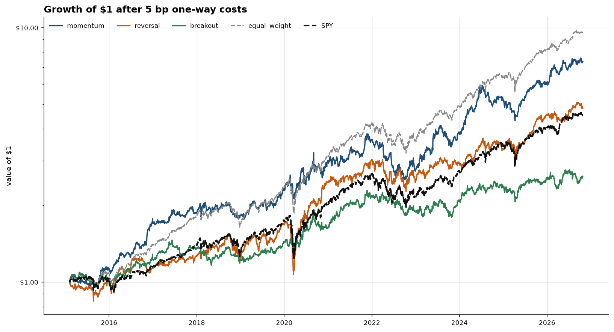
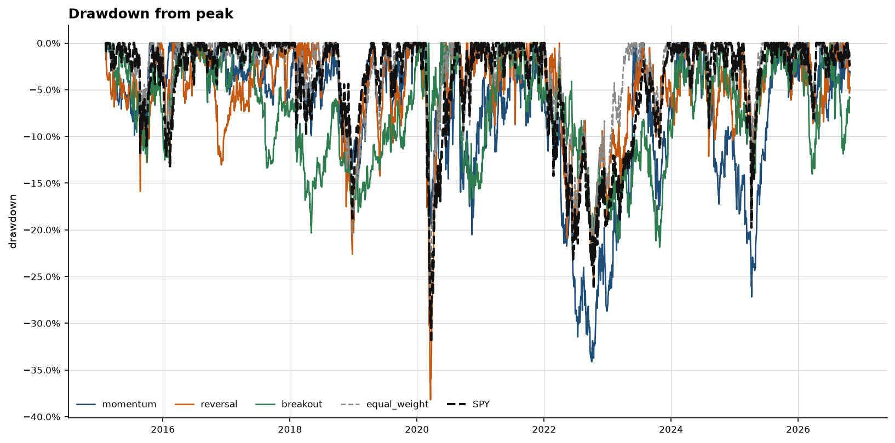
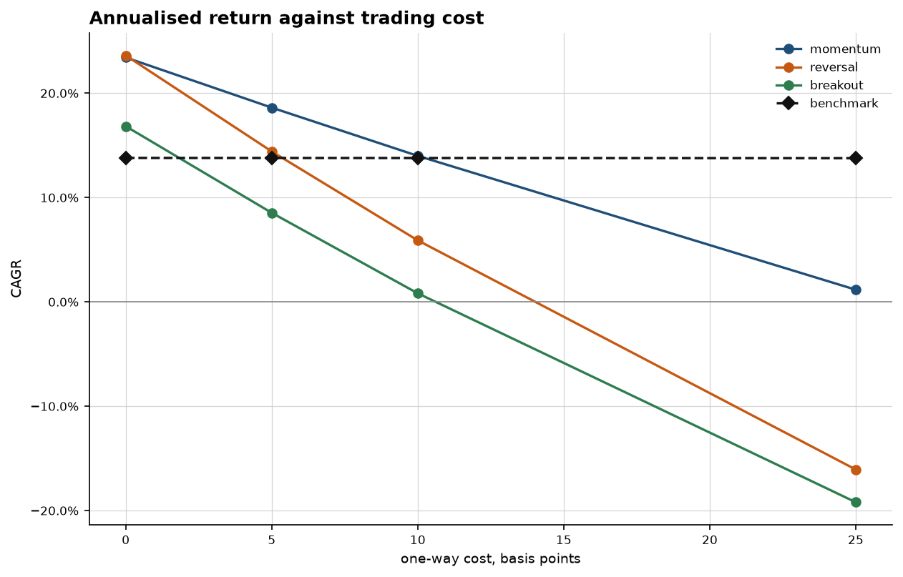

# Backtest — baseline

Three long-only strategies on the configured universe (AAPL, MSFT, NVDA, JPM, XOM, JNJ, QQQ, IWM, TLT, GLD), marked from 2015-02-05 to 2026-10-26. Signals start being tradable on 2015-02-03; sessions before that are warmup and are not in these numbers. The benchmark is SPY. The second benchmark is an equal-weight buy-and-hold of the same names, which is the honest null: it is what you get for owning the universe and doing nothing else.

None of the three strategies beat equal-weight buy-and-hold of the same names (21.3% CAGR) after 5 bp. That is the result that matters: reshuffling this universe, after costs, did not beat owning it. Momentum and reversal beat SPY (13.8%). A lead over the index, on a list of names that exist today, is not yet a tradable edge. Section 7 is why.

## 1. The rules

Each strategy emits a score per (date, symbol) and nothing else. The book is built afterwards, the same way for all three: hold the top 3 scores in equal weight (`1 / 3` each), long only, and leave any unfilled slot in cash. A day with fewer eligible names does not concentrate into the names that happened to have data.

Parameters are the ones in the config. They were set as the short-horizon rules in `ROADMAP.md` and were not searched against this sample.

**Momentum.** Long the names with the strongest 20-session total return, skipping the most recent session. The score is the cross-sectional percentile of that return: 1 is the strongest name that day, and a name without a full window is left blank rather than ranked on a partial one. The skipped session is the short-term reversal that otherwise contaminates a one-month momentum signal. 20 sessions is about a month, which is the long end of the holding horizon this engine is built for, and it was chosen for that reason rather than by scanning other windows.

**Reversal.** Long the names with the most negative 5-session return per unit of trailing 20-session volatility. Dividing by volatility is the whole point: a 5% move in a bond ETF and a 5% move in a single stock are not the same event, and a rule that treats them as one is mostly a volatility rank. The score is the percentile of the negated ratio, so the sharpest vol-adjusted drop ranks first. A name whose trailing volatility is flat has no defined ratio and is left blank.

**Breakout.** Long the names closest to their own trailing 20-session high. Distance is close divided by that high, minus one, so a new high scores 0 and everything else scores negative, and the percentile rank puts the names at their highs first. This is the trend-following counterweight to the reversal rule. The window matches the momentum window on purpose: same horizon, opposite construction, so a high correlation between them would mean they are one strategy.

## 2. How a score becomes a return

- The score on session t uses prices through t's close and no later.
- The position is entered at the **open of t+1**, never at t's close. The trade log records that raw open, which is the price that was on the screen.
- P&L from that open to the next session's open uses the **adjusted** open: raw open times `adj_close / close` that day. A split that halves the printed open does not become a -50% return, and a dividend does not become a loss. The adjustment is the close's own factor, not a model of the intraday path.
- Cost is **5 bp per side**, charged on the notional that changed hands (`sum |Δweight|`), taken out of the account at the entry open before the move. One-way turnover is half of that sum, so replacing the whole book is 1.
- A target whose next open is missing or non-positive is not filled. Its weight stays cash and earns zero. It is not given a carried price.
- No intraday stop. A daily bar cannot order the low against the high.
- Cash earns zero. The Sharpe ratio still subtracts the configured daily risk-free rate (2.00% annual, de-annualised geometrically), so a flat book does not look skilled.
- The last two sessions of the panel are not marked. A completed hold needs an entry open and a following open, and those sessions do not have both yet.

## 3. Results

| book         | CAGR   | vol   | Sharpe   | max DD   | hit rate   | hold (sessions)   | turnover / yr   | CAGR vs SPY   | alpha / yr   |
|:-------------|:-------|:------|:---------|:---------|:-----------|:------------------|:----------------|:--------------|:-------------|
| momentum     | 18.6%  | 20.2% | 0.85     | -34.1%   | 55.1%      | 6.3               | 39.73x          | +4.8 pp       | 8.2%         |
| reversal     | 14.4%  | 20.5% | 0.66     | -38.2%   | 52.2%      | 3.3               | 77.35x          | +0.6 pp       | 2.2%         |
| breakout     | 8.5%   | 15.6% | 0.48     | -21.9%   | 53.7%      | 3.4               | 73.67x          | -5.3 pp       | 1.2%         |
| equal_weight | 21.3%  | 15.6% | 1.19     | -26.8%   | 56.7%      | 2948.0            | 0.04x           | +7.5 pp       | 7.8%         |
| SPY          | 13.8%  | 16.8% | 0.73     | -32.0%   | 56.1%      | 2948.0            | 0.04x           | +0.0 pp       | 0.0%         |

CAGR is geometric. Volatility is the daily sample standard deviation times sqrt(252). Sharpe uses the daily risk-free rate. Alpha is the CAPM intercept, annualised by multiplying the daily intercept by 252, which is the right operation for an average abnormal return and the wrong one to confuse with the gap between two CAGRs. Holding period is the mean length of consecutive spells in the book, in sessions. Turnover is the mean fraction of the book traded one-way each session, times 252, written as a multiple of the book: 40x means the positions were replaced about forty times in a year. The buy-and-hold books are near 0x because they pay the cost once.

**momentum.** CAGR 18.6% (+4.8 pp versus SPY, -2.7 pp versus equal-weight), volatility 20.2%, Sharpe 0.85, max drawdown -34.1%, CAPM alpha 8.2% a year. Average holding period 6.3 sessions, inside the one-day to one-month band this engine is built for. Annualised one-way turnover 39.73x. NVDA was in the book on 54% of decision dates. With 3 slots, that is a concentrated bet, and the CAGR is not separable from the path of NVDA without a larger universe.

**reversal.** CAGR 14.4% (+0.6 pp versus SPY, -6.9 pp versus equal-weight), volatility 20.5%, Sharpe 0.66, max drawdown -38.2%, CAPM alpha 2.2% a year. Average holding period 3.3 sessions, inside the one-day to one-month band this engine is built for. Annualised one-way turnover 77.35x. No single name occupied a slot on a majority of days. The most frequent was TLT at 42%.

**breakout.** CAGR 8.5% (-5.3 pp versus SPY, -12.8 pp versus equal-weight), volatility 15.6%, Sharpe 0.48, max drawdown -21.9%, CAPM alpha 1.2% a year. Average holding period 3.4 sessions, inside the one-day to one-month band this engine is built for. Annualised one-way turnover 73.67x. No single name occupied a slot on a majority of days. The most frequent was GLD at 37%.

Equal-weight buy-and-hold of the universe returned 21.3% a year against SPY's 13.8%. The universe itself beat SPY, so a strategy has to clear a higher bar than the index before it has done anything the passive book of the same names did not already do.

## 4. Costs

The same weights, rerun at each cost. The benchmark pays the cost once, on the way in, so its CAGR barely moves. The strategies pay it on every rebalance, which is where a signal that looked real goes to die.

| book     | 0 bp   | 5 bp   | 10 bp   | 25 bp   |
|:---------|:-------|:-------|:--------|:--------|
| momentum | 23.4%  | 18.6%  | 14.0%   | 1.2%    |
| reversal | 23.6%  | 14.4%  | 5.9%    | -16.1%  |
| breakout | 16.8%  | 8.5%   | 0.8%    | -19.2%  |
| SPY      | 13.8%  | 13.8%  | 13.8%   | 13.8%   |

**momentum** breaks even with SPY near 10.2 bp one-way. The stated 5 bp cost is still on the side of that line where the strategy leads.
**reversal** breaks even with SPY near 5.4 bp one-way. The stated 5 bp cost is still on the side of that line where the strategy leads.
**breakout** breaks even with SPY near 1.8 bp one-way, which is below the stated 5 bp. At the cost this report uses, the lead over SPY is already gone.

The stated assumption for the headline table is 5 bp per side. Anything that only leads at 0 bp is a gross of the signal, not a strategy.

## 5. Are these three strategies or one?

Correlation of the scores themselves, stacked over every (date, symbol) in the common window. Portfolio-return correlation would mostly measure the fact that all three books hold equities. Score correlation measures whether the rules agree.

| score    | momentum   | reversal   | breakout   |
|:---------|:-----------|:-----------|:-----------|
| momentum | 1.00       | -0.33      | 0.54       |
| reversal | -0.33      | 1.00       | -0.61      |
| breakout | 0.54       | -0.61      | 1.00       |

The strongest relationship is reversal versus breakout at -0.61. They disagree, which is what a trend rule and a reversal rule are supposed to do. Neither pair is high enough to collapse the three into one.

## 6. Figures

**Growth of $1, strategies against the two benchmarks**

**Drawdown from peak**

**CAGR against one-way cost**

## 7. Assumptions that change the numbers

1. **Total-return prices for every signal.** Momentum and reversal are return signals, so `adj_close` is the right series. The breakout is a price pattern. It should be measured on a split-adjusted series that has **not** been dividend-adjusted, because a dividend is not a break of support. That series does not exist yet (ROADMAP phase 2), so the breakout uses `adj_close` too. On a high-dividend name a payout looks like a step down, and the breakout score moves for a reason that is not a price.
2. **Adjusted open = raw open × (adj_close / close).** This is a reconstruction, not a vendor field. It is right about splits and about the close-to-close dividend, and silent about any corporate action that did not land in `adj_close`.
3. **Long only, equal weight, fixed top-N.** No short book, no volatility targeting, no cap on how much of a day's volume the weight implies. A 33% weight in one name is a position a real book of any size would have to justify, and nothing here checks the volume.
4. **A flat 5 bp one-way cost**, the same for every name. TLT and a single stock do not cost the same to trade. The sweep in section 4 is the sensitivity to that number, not a market-impact model.
5. **No intraday stop, and no same-bar fill.** Both are consequences of using daily bars, not omissions to be patched by assuming a path inside the bar.
6. **The universe is ten names that exist today.** Every result on it is conditional on their survival. A name that was delisted along the way is not here to have lost money, and the fix is a point-in-time membership list, which this milestone does not have.
7. **Cash earns zero**, while Sharpe subtracts a flat 2.00% risk-free rate. An unfilled slot is therefore a drag against both the benchmark and the Sharpe ratio.
8. **The warmup is dropped, and the last two sessions are not marked.** The window in this report is the one on which every strategy could actually fire and every hold could actually complete.
9. **A provisional last bar is not refused.** If this report was built on a session that had not closed, the newest close is a partial print and the newest score will change by the end of the day. Hard refusal of that bar is ROADMAP phase 4. It is not implemented here.
10. **Parameters were not fit to this sample.** That is a choice. It means a disappointing CAGR is evidence about the rule, not a cue to go and find a window that would have worked.

