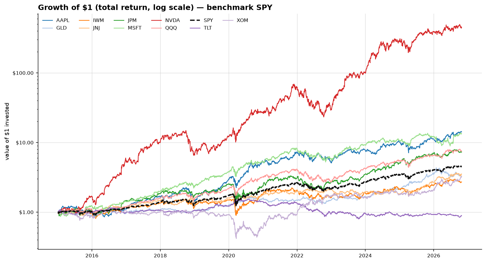
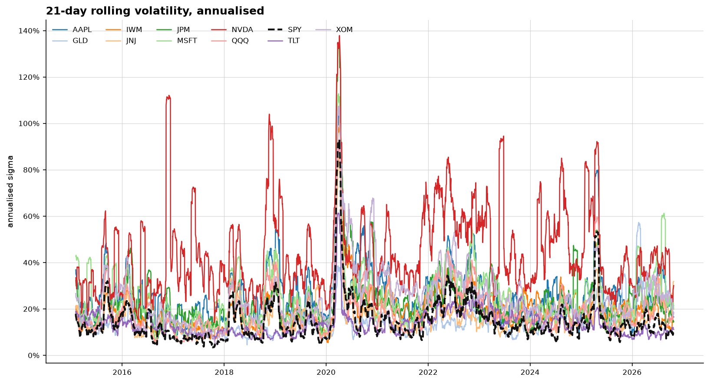
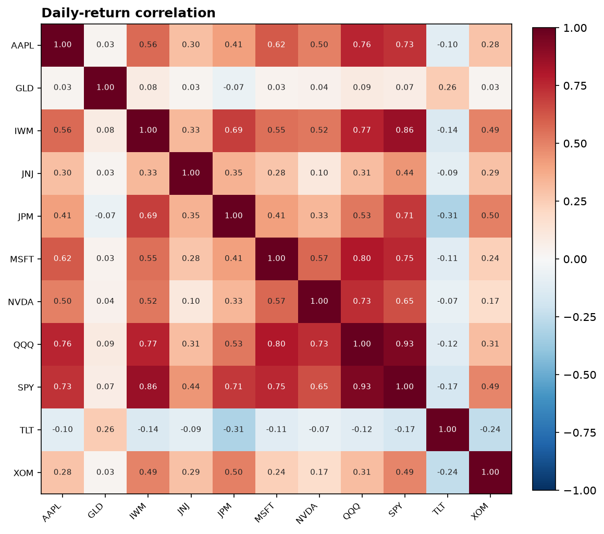
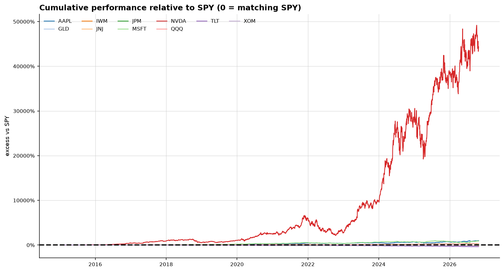
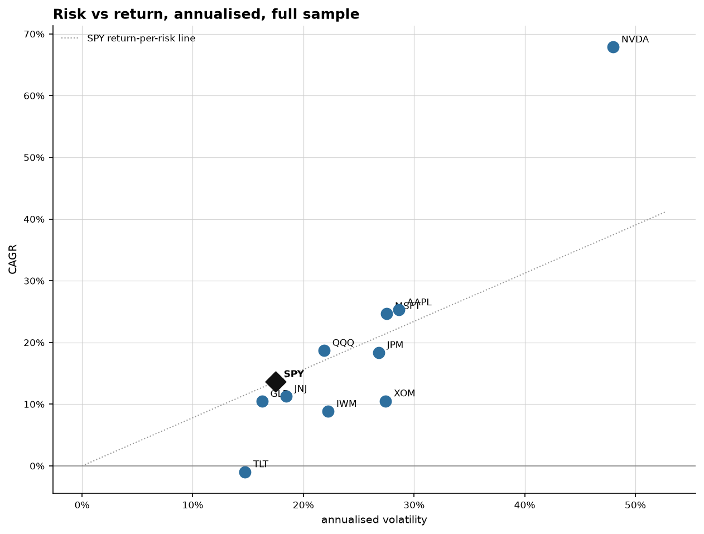

# MarketEngine — run `baseline`

*Generated 2026-10-26 21:49 UTC from `config\default.yml` (sha256 `89edcc84880a…`).*

- **Provider:** `yfinance`
- **Universe:** AAPL, MSFT, NVDA, JPM, XOM, JNJ, QQQ, IWM, TLT, GLD
- **Benchmark:** `SPY`
- **Effective window:** 2015-01-02 → 2026-10-26 (2,971 sessions, 32,681 panel rows)
- **Calendar:** aligned to `benchmark`, prices never forward-filled; sessions with no bar are dropped
- **Risk-free:** 2.00% annual (0.007858% daily) for Sharpe and CAPM alpha

## 1. Absolute performance and risk

Returns are computed from `adj_close` (split- and dividend-adjusted), so these are total returns. `var_95_1d` is the empirical 5th percentile of daily returns, not a Gaussian approximation.

| symbol   |   n_obs | first_date   | total_return   | cagr   | ann_volatility   |   sharpe |   sortino | max_drawdown   | max_dd_trough   | hit_rate   | var_95_1d   |
|:---------|--------:|:-------------|:---------------|:-------|:-----------------|---------:|----------:|:---------------|:----------------|:-----------|:------------|
| SPY      |    2970 | 2015-01-05   | 352.17%        | 13.66% | 17.50%           |     0.71 |      0.99 | -33.72%        | 2020-03-23      | 54.58%     | -1.64%      |
| NVDA     |    2970 | 2015-01-05   | 44,724.08%     | 67.87% | 48.01%           |     1.28 |      1.97 | -66.34%        | 2022-10-14      | 54.24%     | -4.41%      |
| MSFT     |    2970 | 2015-01-05   | 1,244.71%      | 24.67% | 27.54%           |     0.87 |      1.29 | -37.15%        | 2022-11-03      | 53.30%     | -2.65%      |
| AAPL     |    2970 | 2015-01-05   | 1,322.78%      | 25.27% | 28.64%           |     0.86 |      1.26 | -38.52%        | 2019-01-03      | 53.16%     | -2.71%      |
| QQQ      |    2970 | 2015-01-05   | 653.95%        | 18.70% | 21.88%           |     0.8  |      1.14 | -35.12%        | 2022-11-03      | 55.93%     | -2.20%      |
| JPM      |    2970 | 2015-01-05   | 628.74%        | 18.36% | 26.82%           |     0.69 |      1.01 | -43.63%        | 2020-03-23      | 52.42%     | -2.51%      |
| GLD      |    2970 | 2015-01-05   | 222.42%        | 10.44% | 16.28%           |     0.57 |      0.8  | -26.40%        | 2026-07-16      | 53.06%     | -1.58%      |
| JNJ      |    2970 | 2015-01-05   | 251.61%        | 11.26% | 18.45%           |     0.56 |      0.81 | -27.37%        | 2020-03-23      | 52.12%     | -1.64%      |
| XOM      |    2970 | 2015-01-05   | 225.02%        | 10.52% | 27.44%           |     0.43 |      0.62 | -61.34%        | 2020-03-23      | 51.35%     | -2.59%      |
| IWM      |    2970 | 2015-01-05   | 170.83%        | 8.82%  | 22.25%           |     0.4  |      0.56 | -41.13%        | 2020-03-23      | 52.93%     | -2.06%      |
| TLT      |    2970 | 2015-01-05   | -10.80%        | -0.96% | 14.74%           |    -0.13 |     -0.18 | -48.35%        | 2023-10-19      | 51.11%     | -1.48%      |

## 2. Performance relative to SPY

`beta`, `alpha_annual` and `r_squared` come from an OLS regression of excess returns on SPY's excess returns. `alpha_annual` is annualised arithmetically (daily alpha x 252) because alpha is an average per-period abnormal return, not a compounded path. `up_capture` of 1.20 means that on an average day SPY rose, the symbol rose 20% more than SPY did; `down_capture` above 1 means it fell more than SPY on an average down day. Both are ratios of geometric mean per-day returns rather than of compounded totals, which over a sample this long saturate against +infinity and -100% and stop discriminating.

| symbol   |   beta | alpha_annual   |   corr_to_benchmark |   r_squared | tracking_error   |   information_ratio | active_return_annual   |   up_capture |   down_capture |
|:---------|-------:|:---------------|--------------------:|------------:|:-----------------|--------------------:|:-----------------------|-------------:|---------------:|
| SPY      |   1    | 0.00%          |                1    |        1    | 0.00%            |                     | 0.00%                  |         1    |           1    |
| NVDA     |   1.77 | 39.40%         |                0.65 |        0.42 | 39.07%           |                1.25 | 54.21%                 |         2.02 |           1.7  |
| MSFT     |   1.18 | 9.24%          |                0.75 |        0.56 | 18.45%           |                0.62 | 11.01%                 |         1.24 |           1.15 |
| AAPL     |   1.19 | 9.96%          |                0.73 |        0.53 | 19.97%           |                0.62 | 11.61%                 |         1.2  |           1.12 |
| QQQ      |   1.17 | 3.16%          |                0.93 |        0.87 | 8.46%            |                0.62 | 5.04%                  |         1.23 |           1.21 |
| JPM      |   1.08 | 5.06%          |                0.71 |        0.5  | 19.00%           |                0.32 | 4.70%                  |         1.05 |           1.02 |
| GLD      |   0.07 | 8.43%          |                0.07 |        0.01 | 23.00%           |               -0.13 | -3.22%                 |         0.12 |           0.02 |
| JNJ      |   0.46 | 4.67%          |                0.44 |        0.19 | 19.05%           |               -0.1  | -2.40%                 |         0.4  |           0.34 |
| XOM      |   0.77 | 2.31%          |                0.49 |        0.24 | 24.28%           |               -0.02 | -3.14%                 |         0.67 |           0.66 |
| IWM      |   1.1  | -4.63%         |                0.86 |        0.75 | 11.31%           |               -0.3  | -4.84%                 |         1.12 |           1.19 |
| TLT      |  -0.14 | -0.11%         |               -0.17 |        0.03 | 24.71%           |               -0.58 | -14.62%                |        -0.11 |          -0.12 |

## 3. Correlation of daily returns

Pairwise-complete Pearson correlation, blank where two symbols share fewer than 250 sessions.

|      |   AAPL |    GLD |    IWM |    JNJ |    JPM |   MSFT |   NVDA |    QQQ |    SPY |    TLT |    XOM |
|:-----|-------:|-------:|-------:|-------:|-------:|-------:|-------:|-------:|-------:|-------:|-------:|
| AAPL |  1     |  0.027 |  0.563 |  0.299 |  0.411 |  0.616 |  0.504 |  0.765 |  0.726 | -0.103 |  0.282 |
| GLD  |  0.027 |  1     |  0.082 |  0.03  | -0.067 |  0.034 |  0.045 |  0.089 |  0.074 |  0.255 |  0.03  |
| IWM  |  0.563 |  0.082 |  1     |  0.327 |  0.694 |  0.548 |  0.525 |  0.767 |  0.865 | -0.143 |  0.493 |
| JNJ  |  0.299 |  0.03  |  0.327 |  1     |  0.349 |  0.277 |  0.104 |  0.306 |  0.439 | -0.095 |  0.292 |
| JPM  |  0.411 | -0.067 |  0.694 |  0.349 |  1     |  0.413 |  0.332 |  0.53  |  0.708 | -0.311 |  0.503 |
| MSFT |  0.616 |  0.034 |  0.548 |  0.277 |  0.413 |  1     |  0.573 |  0.802 |  0.751 | -0.112 |  0.236 |
| NVDA |  0.504 |  0.045 |  0.525 |  0.104 |  0.332 |  0.573 |  1     |  0.734 |  0.646 | -0.072 |  0.174 |
| QQQ  |  0.765 |  0.089 |  0.767 |  0.306 |  0.53  |  0.802 |  0.734 |  1     |  0.932 | -0.116 |  0.312 |
| SPY  |  0.726 |  0.074 |  0.865 |  0.439 |  0.708 |  0.751 |  0.646 |  0.932 |  1     | -0.168 |  0.489 |
| TLT  | -0.103 |  0.255 | -0.143 | -0.095 | -0.311 | -0.112 | -0.072 | -0.116 | -0.168 |  1     | -0.243 |
| XOM  |  0.282 |  0.03  |  0.493 |  0.292 |  0.503 |  0.236 |  0.174 |  0.312 |  0.489 | -0.243 |  1     |

## 4. Data quality

Every requested symbol was retrieved.

Every check flags rather than deletes. The only rows that leave the analytical table are structural impossibilities — a non-positive price, or a bar whose high is below its own low, open or close — which cannot be interpreted at all, and sessions with no vendor bar. Both keep their values in the event log.

| flag              |   rows |
|:------------------|-------:|
| MISSING_SESSION   |      0 |
| FORWARD_FILLED    |      0 |
| DUPLICATE_DATE    |      0 |
| NONPOSITIVE_PRICE |      0 |
| OHLC_INCONSISTENT |      0 |
| EXTREME_RETURN    |     16 |
| STALE_PRICE       |      0 |
| ZERO_VOLUME       |      0 |

Symbols with something worth knowing about (all of it recorded, none of it silently corrected):

| symbol   |   rows |   coverage_pct |   rows_quarantined |   gaps_found |   gaps_forward_filled |   rows_dropped_missing | short_history   | adj_close_equals_close   |
|:---------|-------:|---------------:|-------------------:|-------------:|----------------------:|-----------------------:|:----------------|:-------------------------|
| GLD      |   2971 |            100 |                  0 |            0 |                     0 |                      0 | False           | True                     |

16 quality event(s) logged. Per-symbol counts: `data\outputs\baseline\data_quality.csv`; per-row detail with the triggering values: `data\outputs\baseline\quality_events.csv`.

## 5. Figures

**Growth of $1, total return, log scale**

**21-day rolling volatility, annualised**

**Daily-return correlation matrix**

**Cumulative performance relative to SPY**

**Risk vs return, annualised**

## 6. Assumptions that change the numbers

1. **Total return, not price return.** All returns use `adj_close`. Using `close` would read each dividend as a price fall and understate every dividend payer in the universe.
2. **The benchmark defines the trading calendar** (`calendar.align: benchmark`). A date SPY did not trade has no benchmark return, so no relative statistic exists for it.
3. **Prices are not forward-filled.** A carried price is a fabricated 0% return followed by a fabricated real one, which at a one-day-to-one-month holding period is large enough to look like a signal, and filling past a security's last quote manufactures a zero-volatility series that every risk statistic then rewards. Sessions with no vendor bar are flagged `MISSING_SESSION` and dropped, so a return spanning the hole is honestly a two-day return rather than a made-up pair of one-day returns.
4. **Volume is never forward-filled.** A carried bar has unknown volume, and NaN is what unknown means; a carried volume would invent trading activity.
5. **Nothing is dropped for being surprising.** Extreme moves, zero-volume sessions and stale price runs are flagged by name in the panel's `flags` column and kept in the data. A 45% single-day move is usually real, and deleting it is the actual error.
6. **An extreme return is |r| > 50% OR |r| > 8 trailing standard deviations** over 20 sessions ending *before* the bar being tested, so an outlier cannot inflate its own yardstick. One test alone is not enough: the absolute threshold catches decimal-point errors on quiet bond ETFs, the relative one catches bad prints on names that routinely move 15%.
7. **The risk-free rate is a flat 2.00% assumption**, de-annualised geometrically. Swap in a real T-bill series before quoting a Sharpe ratio anywhere it matters.
8. **Pairwise windows.** A symbol with less history than SPY is compared against it only over the sessions they share; `overlap_with_benchmark` in `metrics_summary.csv` reports how many that was.
