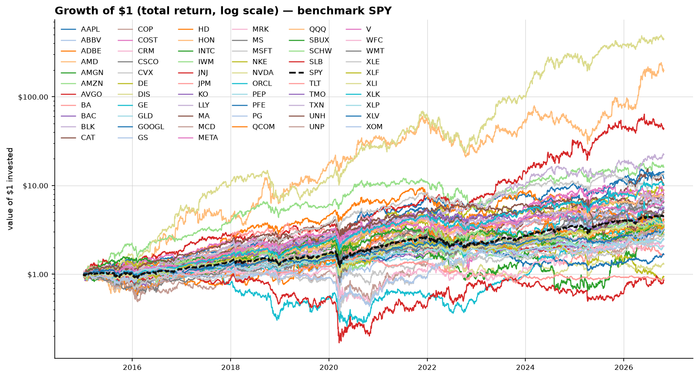
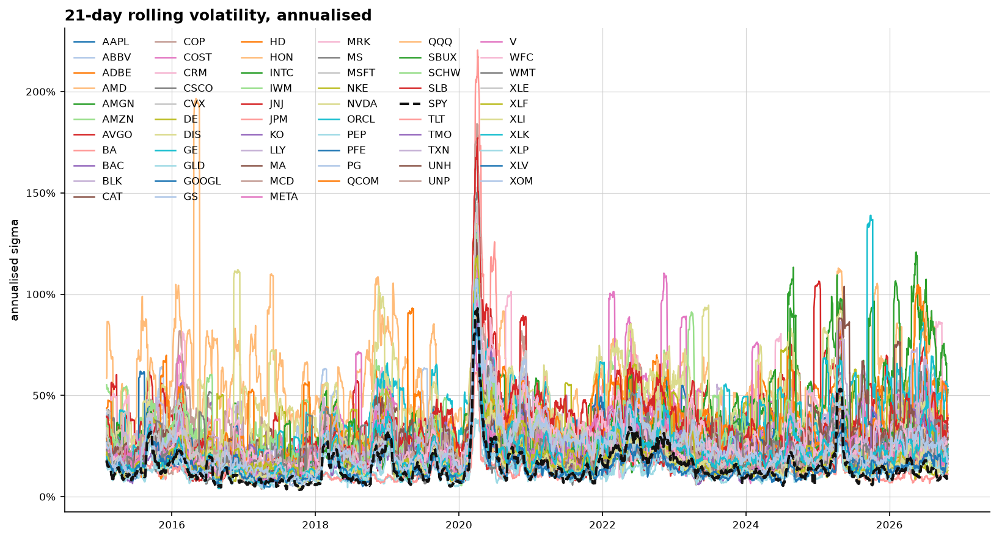
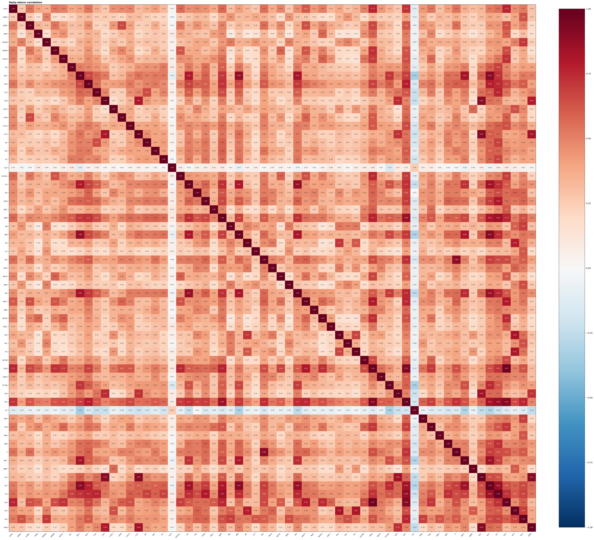
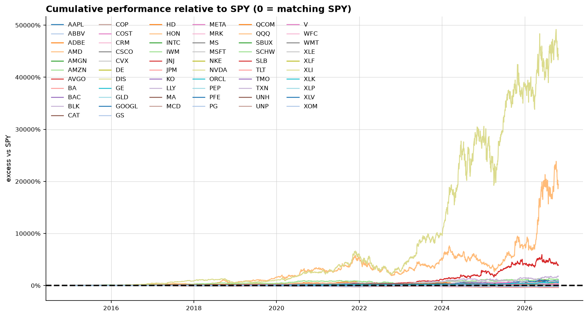
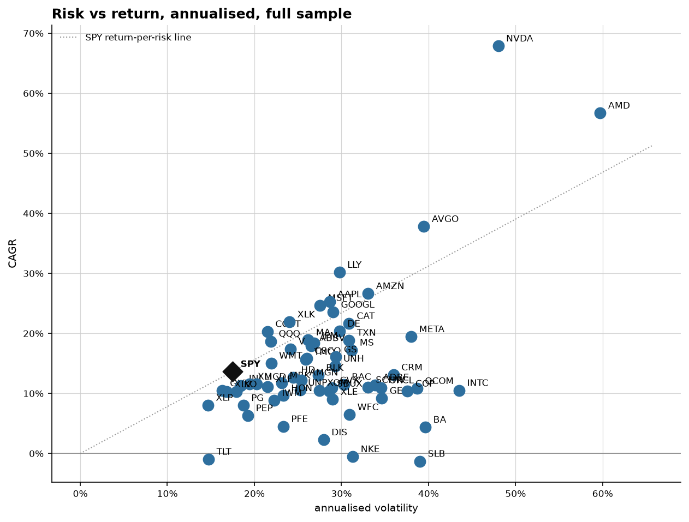

# MarketEngine — run `validation`

*Generated 2026-10-28 01:26 UTC from `config\validation.yml` (sha256 `7c2a34795454…`).*

- **Provider:** `yfinance`
- **Universe:** AAPL, MSFT, NVDA, GOOGL, AMZN, META, AVGO, AMD, ORCL, CRM, ADBE, CSCO, INTC, TXN, QCOM, JPM, BAC, WFC, GS, MS, BLK, SCHW, V, MA, JNJ, UNH, PFE, MRK, ABBV, LLY, AMGN, TMO, XOM, CVX, COP, SLB, WMT, HD, COST, KO, PEP, MCD, NKE, SBUX, DIS, PG, CAT, DE, HON, UNP, BA, GE, QQQ, IWM, TLT, GLD, XLF, XLE, XLK, XLV, XLI, XLP
- **Benchmark:** `SPY`
- **Effective window:** 2015-01-02 → 2026-10-26 (2,971 sessions, 187,173 panel rows)
- **Calendar:** aligned to `benchmark`, prices never forward-filled; sessions with no bar are dropped
- **Risk-free:** 2.00% annual (0.007858% daily) for Sharpe and CAPM alpha

## 1. Absolute performance and risk

Returns are computed from `adj_close` (split- and dividend-adjusted), so these are total returns. `var_95_1d` is the empirical 5th percentile of daily returns, not a Gaussian approximation.

| symbol   |   n_obs | first_date   | total_return   | cagr   | ann_volatility   |   sharpe |   sortino | max_drawdown   | max_dd_trough   | hit_rate   | var_95_1d   |
|:---------|--------:|:-------------|:---------------|:-------|:-----------------|---------:|----------:|:---------------|:----------------|:-----------|:------------|
| SPY      |    2970 | 2015-01-05   | 352.17%        | 13.66% | 17.50%           |     0.71 |      0.99 | -33.72%        | 2020-03-23      | 54.58%     | -1.64%      |
| NVDA     |    2970 | 2015-01-05   | 44,724.08%     | 67.87% | 48.01%           |     1.28 |      1.97 | -66.34%        | 2022-10-14      | 54.24%     | -4.41%      |
| AMD      |    2970 | 2015-01-05   | 19,798.13%     | 56.69% | 59.73%           |     1.01 |      1.61 | -65.45%        | 2022-10-14      | 50.91%     | -5.37%      |
| LLY      |    2970 | 2015-01-05   | 2,136.24%      | 30.17% | 29.76%           |     0.97 |      1.5  | -34.48%        | 2025-08-08      | 53.23%     | -2.56%      |
| AVGO     |    2970 | 2015-01-05   | 4,277.90%      | 37.80% | 39.47%           |     0.96 |      1.45 | -48.30%        | 2020-03-18      | 53.10%     | -3.58%      |
| COST     |    2970 | 2015-01-05   | 784.56%        | 20.32% | 21.50%           |     0.88 |      1.26 | -31.40%        | 2022-05-20      | 53.70%     | -1.98%      |
| MSFT     |    2970 | 2015-01-05   | 1,244.71%      | 24.67% | 27.54%           |     0.87 |      1.29 | -37.15%        | 2022-11-03      | 53.30%     | -2.65%      |
| XLK      |    2970 | 2015-01-05   | 932.72%        | 21.91% | 24.03%           |     0.86 |      1.24 | -33.56%        | 2022-10-12      | 55.79%     | -2.41%      |
| AAPL     |    2970 | 2015-01-05   | 1,322.78%      | 25.27% | 28.64%           |     0.86 |      1.26 | -38.52%        | 2019-01-03      | 53.16%     | -2.71%      |
| AMZN     |    2970 | 2015-01-05   | 1,514.74%      | 26.62% | 33.06%           |     0.82 |      1.24 | -56.15%        | 2022-12-28      | 53.06%     | -3.06%      |
| GOOGL    |    2970 | 2015-01-05   | 1,107.87%      | 23.54% | 29.03%           |     0.8  |      1.19 | -44.32%        | 2022-11-03      | 53.37%     | -2.70%      |
| QQQ      |    2970 | 2015-01-05   | 653.95%        | 18.70% | 21.88%           |     0.8  |      1.14 | -35.12%        | 2022-11-03      | 55.93%     | -2.20%      |
| CAT      |    2970 | 2015-01-05   | 906.94%        | 21.65% | 30.84%           |     0.73 |      1.06 | -43.36%        | 2020-03-23      | 52.29%     | -2.97%      |
| MA       |    2970 | 2015-01-05   | 670.79%        | 18.92% | 26.16%           |     0.72 |      1.04 | -41.00%        | 2020-03-23      | 54.71%     | -2.50%      |
| DE       |    2970 | 2015-01-05   | 789.48%        | 20.37% | 29.77%           |     0.71 |      1.04 | -37.91%        | 2020-03-23      | 52.02%     | -2.70%      |
| V        |    2970 | 2015-01-05   | 562.83%        | 17.41% | 24.16%           |     0.7  |      1.02 | -36.36%        | 2020-03-23      | 54.44%     | -2.29%      |
| JPM      |    2970 | 2015-01-05   | 628.74%        | 18.36% | 26.82%           |     0.69 |      1.01 | -43.63%        | 2020-03-23      | 52.42%     | -2.51%      |
| ABBV     |    2970 | 2015-01-05   | 601.62%        | 17.98% | 26.55%           |     0.68 |      0.95 | -45.09%        | 2019-08-15      | 53.77%     | -2.37%      |
| WMT      |    2970 | 2015-01-05   | 421.36%        | 15.04% | 21.93%           |     0.66 |      0.96 | -36.44%        | 2015-11-13      | 53.13%     | -1.89%      |
| TXN      |    2970 | 2015-01-05   | 666.31%        | 18.86% | 30.88%           |     0.65 |      0.96 | -33.41%        | 2025-04-21      | 53.00%     | -2.84%      |
| CSCO     |    2970 | 2015-01-05   | 466.63%        | 15.86% | 26.00%           |     0.62 |      0.88 | -41.95%        | 2020-03-12      | 52.63%     | -2.27%      |
| TMO      |    2970 | 2015-01-05   | 454.21%        | 15.64% | 25.93%           |     0.61 |      0.9  | -40.95%        | 2025-06-17      | 52.79%     | -2.43%      |
| META     |    2970 | 2015-01-05   | 711.47%        | 19.44% | 38.02%           |     0.61 |      0.88 | -76.74%        | 2022-11-03      | 52.32%     | -3.39%      |
| MS       |    2970 | 2015-01-05   | 549.52%        | 17.21% | 31.19%           |     0.6  |      0.88 | -51.33%        | 2020-03-23      | 52.05%     | -2.88%      |
| GS       |    2970 | 2015-01-05   | 479.61%        | 16.08% | 29.37%           |     0.59 |      0.86 | -48.75%        | 2020-03-23      | 51.78%     | -2.62%      |
| GLD      |    2970 | 2015-01-05   | 222.42%        | 10.44% | 16.28%           |     0.57 |      0.8  | -26.40%        | 2026-07-16      | 53.06%     | -1.58%      |
| JNJ      |    2970 | 2015-01-05   | 251.61%        | 11.26% | 18.45%           |     0.56 |      0.81 | -27.37%        | 2020-03-23      | 52.12%     | -1.64%      |
| XLI      |    2970 | 2015-01-05   | 263.16%        | 11.56% | 19.47%           |     0.56 |      0.79 | -42.33%        | 2020-03-23      | 53.80%     | -1.84%      |
| XLV      |    2970 | 2015-01-05   | 216.80%        | 10.28% | 16.80%           |     0.55 |      0.78 | -28.40%        | 2020-03-23      | 52.69%     | -1.56%      |
| UNH      |    2970 | 2015-01-05   | 395.76%        | 14.55% | 29.31%           |     0.55 |      0.76 | -61.39%        | 2025-08-01      | 52.36%     | -2.37%      |
| MCD      |    2970 | 2015-01-05   | 261.89%        | 11.53% | 20.22%           |     0.54 |      0.79 | -36.90%        | 2020-03-23      | 52.59%     | -1.70%      |
| HD       |    2970 | 2015-01-05   | 308.39%        | 12.68% | 24.44%           |     0.53 |      0.75 | -37.99%        | 2020-03-20      | 52.46%     | -2.30%      |
| KO       |    2970 | 2015-01-05   | 217.29%        | 10.29% | 17.91%           |     0.53 |      0.74 | -36.99%        | 2020-03-23      | 52.29%     | -1.57%      |
| BLK      |    2970 | 2015-01-05   | 322.61%        | 13.01% | 27.32%           |     0.51 |      0.74 | -43.90%        | 2022-10-12      | 52.22%     | -2.52%      |
| MRK      |    2970 | 2015-01-05   | 270.17%        | 11.74% | 23.12%           |     0.51 |      0.75 | -43.44%        | 2025-05-14      | 51.14%     | -2.12%      |
| XLF      |    2970 | 2015-01-05   | 246.64%        | 11.12% | 21.51%           |     0.51 |      0.72 | -42.86%        | 2020-03-23      | 52.26%     | -1.99%      |
| AMGN     |    2970 | 2015-01-05   | 289.68%        | 12.23% | 25.40%           |     0.5  |      0.74 | -24.86%        | 2023-06-01      | 51.75%     | -2.39%      |
| CRM      |    2970 | 2015-01-05   | 325.96%        | 13.08% | 35.97%           |     0.47 |      0.69 | -58.67%        | 2026-06-22      | 51.92%     | -3.40%      |
| XLP      |    2970 | 2015-01-05   | 148.58%        | 8.03%  | 14.66%           |     0.47 |      0.66 | -24.51%        | 2020-03-23      | 52.29%     | -1.34%      |
| BAC      |    2970 | 2015-01-05   | 261.39%        | 11.52% | 30.27%           |     0.45 |      0.65 | -48.95%        | 2020-03-23      | 51.25%     | -2.81%      |
| UNP      |    2970 | 2015-01-05   | 225.34%        | 10.53% | 25.24%           |     0.44 |      0.65 | -43.16%        | 2016-01-25      | 51.52%     | -2.34%      |
| CVX      |    2970 | 2015-01-05   | 239.68%        | 10.93% | 28.90%           |     0.44 |      0.62 | -55.77%        | 2020-03-23      | 52.49%     | -2.59%      |
| ADBE     |    2970 | 2015-01-05   | 257.51%        | 11.42% | 33.86%           |     0.43 |      0.6  | -71.90%        | 2026-06-25      | 53.16%     | -3.26%      |
| XOM      |    2970 | 2015-01-05   | 225.02%        | 10.52% | 27.44%           |     0.43 |      0.62 | -61.34%        | 2020-03-23      | 51.35%     | -2.59%      |
| HON      |    2970 | 2015-01-05   | 195.64%        | 9.63%  | 23.31%           |     0.43 |      0.61 | -43.01%        | 2020-03-23      | 52.90%     | -2.08%      |
| SCHW     |    2970 | 2015-01-05   | 242.64%        | 11.01% | 33.03%           |     0.42 |      0.6  | -51.08%        | 2020-03-12      | 51.48%     | -3.14%      |
| SBUX     |    2970 | 2015-01-05   | 220.14%        | 10.38% | 28.57%           |     0.42 |      0.62 | -43.68%        | 2022-05-11      | 51.25%     | -2.44%      |
| ORCL     |    2970 | 2015-01-05   | 239.90%        | 10.94% | 34.54%           |     0.41 |      0.63 | -64.58%        | 2026-07-24      | 52.76%     | -3.04%      |
| QCOM     |    2970 | 2015-01-05   | 235.71%        | 10.82% | 38.68%           |     0.41 |      0.59 | -44.29%        | 2022-11-03      | 51.78%     | -3.47%      |
| IWM      |    2970 | 2015-01-05   | 170.83%        | 8.82%  | 22.25%           |     0.4  |      0.56 | -41.13%        | 2020-03-23      | 52.93%     | -2.06%      |
| INTC     |    2970 | 2015-01-05   | 224.31%        | 10.50% | 43.53%           |     0.4  |      0.6  | -70.80%        | 2025-04-08      | 50.94%     | -3.76%      |
| COP      |    2970 | 2015-01-05   | 220.37%        | 10.38% | 37.59%           |     0.4  |      0.58 | -70.66%        | 2020-03-18      | 50.07%     | -3.42%      |
| PG       |    2970 | 2015-01-05   | 147.39%        | 7.99%  | 18.73%           |     0.4  |      0.57 | -24.50%        | 2015-09-14      | 52.66%     | -1.72%      |
| XLE      |    2970 | 2015-01-05   | 176.18%        | 9.00%  | 28.98%           |     0.38 |      0.53 | -66.81%        | 2020-03-18      | 52.05%     | -2.65%      |
| GE       |    2970 | 2015-01-05   | 182.37%        | 9.21%  | 34.63%           |     0.37 |      0.54 | -81.19%        | 2020-05-15      | 50.74%     | -3.27%      |
| PEP      |    2970 | 2015-01-05   | 105.62%        | 6.31%  | 19.25%           |     0.31 |      0.44 | -30.32%        | 2025-05-14      | 51.85%     | -1.76%      |
| WFC      |    2970 | 2015-01-05   | 109.19%        | 6.46%  | 30.92%           |     0.29 |      0.42 | -64.46%        | 2020-10-29      | 51.04%     | -2.81%      |
| BA       |    2970 | 2015-01-05   | 65.68%         | 4.38%  | 39.64%           |     0.26 |      0.37 | -77.92%        | 2020-03-20      | 50.71%     | -3.42%      |
| PFE      |    2970 | 2015-01-05   | 67.63%         | 4.48%  | 23.31%           |     0.22 |      0.32 | -58.96%        | 2025-04-10      | 49.19%     | -2.19%      |
| DIS      |    2970 | 2015-01-05   | 30.32%         | 2.27%  | 27.95%           |     0.15 |      0.22 | -60.72%        | 2023-10-04      | 49.93%     | -2.48%      |
| SLB      |    2970 | 2015-01-05   | -14.23%        | -1.29% | 39.01%           |     0.11 |      0.16 | -84.81%        | 2020-03-18      | 49.33%     | -3.66%      |
| NKE      |    2970 | 2015-01-05   | -5.97%         | -0.52% | 31.30%           |     0.08 |      0.11 | -79.09%        | 2026-10-02      | 49.83%     | -2.79%      |
| TLT      |    2970 | 2015-01-05   | -10.80%        | -0.96% | 14.74%           |    -0.13 |     -0.18 | -48.35%        | 2023-10-19      | 51.11%     | -1.48%      |

## 2. Performance relative to SPY

`beta`, `alpha_annual` and `r_squared` come from an OLS regression of excess returns on SPY's excess returns. `alpha_annual` is annualised arithmetically (daily alpha x 252) because alpha is an average per-period abnormal return, not a compounded path. `up_capture` of 1.20 means that on an average day SPY rose, the symbol rose 20% more than SPY did; `down_capture` above 1 means it fell more than SPY on an average down day. Both are ratios of geometric mean per-day returns rather than of compounded totals, which over a sample this long saturate against +infinity and -100% and stop discriminating.

| symbol   |   beta | alpha_annual   |   corr_to_benchmark |   r_squared | tracking_error   |   information_ratio | active_return_annual   |   up_capture |   down_capture |
|:---------|-------:|:---------------|--------------------:|------------:|:-----------------|--------------------:|:-----------------------|-------------:|---------------:|
| SPY      |   1    | 0.00%          |                1    |        1    | 0.00%            |                     | 0.00%                  |         1    |           1    |
| NVDA     |   1.77 | 39.40%         |                0.65 |        0.42 | 39.07%           |                1.25 | 54.21%                 |         2.02 |           1.7  |
| AMD      |   1.77 | 38.58%         |                0.52 |        0.27 | 52.84%           |                0.91 | 43.04%                 |         2.05 |           1.85 |
| LLY      |   0.67 | 20.46%         |                0.4  |        0.16 | 27.92%           |                0.59 | 16.51%                 |         0.7  |           0.5  |
| AVGO     |   1.46 | 19.83%         |                0.65 |        0.42 | 31.15%           |                0.82 | 24.14%                 |         1.61 |           1.47 |
| COST     |   0.67 | 10.52%         |                0.55 |        0.3  | 18.87%           |                0.34 | 6.66%                  |         0.71 |           0.6  |
| MSFT     |   1.18 | 9.24%          |                0.75 |        0.56 | 18.45%           |                0.62 | 11.01%                 |         1.24 |           1.15 |
| XLK      |   1.26 | 5.13%          |                0.92 |        0.84 | 10.53%           |                0.79 | 8.25%                  |         1.33 |           1.29 |
| AAPL     |   1.19 | 9.96%          |                0.73 |        0.53 | 19.97%           |                0.62 | 11.61%                 |         1.2  |           1.12 |
| AMZN     |   1.19 | 12.32%         |                0.63 |        0.4  | 25.86%           |                0.57 | 12.96%                 |         1.35 |           1.26 |
| GOOGL    |   1.15 | 9.09%          |                0.7  |        0.48 | 21.02%           |                0.52 | 9.88%                  |         1.24 |           1.17 |
| QQQ      |   1.17 | 3.16%          |                0.93 |        0.87 | 8.46%            |                0.62 | 5.04%                  |         1.23 |           1.21 |
| CAT      |   1.11 | 8.64%          |                0.63 |        0.4  | 24.02%           |                0.42 | 7.99%                  |         1.25 |           1.2  |
| MA       |   1.1  | 5.18%          |                0.74 |        0.54 | 17.81%           |                0.36 | 5.26%                  |         1.08 |           1.03 |
| DE       |   0.96 | 9.18%          |                0.56 |        0.32 | 24.63%           |                0.35 | 6.72%                  |         0.93 |           0.85 |
| V        |   1    | 4.61%          |                0.73 |        0.53 | 16.63%           |                0.28 | 3.75%                  |         0.97 |           0.92 |
| JPM      |   1.08 | 5.06%          |                0.71 |        0.5  | 19.00%           |                0.32 | 4.70%                  |         1.05 |           1.02 |
| ABBV     |   0.62 | 10.41%         |                0.41 |        0.17 | 25.09%           |                0.23 | 4.32%                  |         0.62 |           0.52 |
| WMT      |   0.5  | 8.26%          |                0.4  |        0.16 | 21.93%           |                0.09 | 1.38%                  |         0.49 |           0.4  |
| TXN      |   1.22 | 4.99%          |                0.69 |        0.48 | 22.67%           |                0.34 | 5.20%                  |         1.29 |           1.28 |
| CSCO     |   0.99 | 3.95%          |                0.66 |        0.44 | 19.45%           |                0.19 | 2.20%                  |         1    |           0.98 |
| TMO      |   0.88 | 5.06%          |                0.59 |        0.35 | 21.00%           |                0.17 | 1.98%                  |         0.9  |           0.87 |
| META     |   1.31 | 6.94%          |                0.6  |        0.36 | 30.85%           |                0.35 | 5.78%                  |         1.34 |           1.32 |
| MS       |   1.34 | 2.24%          |                0.75 |        0.56 | 21.47%           |                0.3  | 3.55%                  |         1.31 |           1.32 |
| GS       |   1.23 | 2.04%          |                0.73 |        0.54 | 20.38%           |                0.24 | 2.42%                  |         1.27 |           1.29 |
| GLD      |   0.07 | 8.43%          |                0.07 |        0.01 | 23.00%           |               -0.13 | -3.22%                 |         0.12 |           0.02 |
| JNJ      |   0.46 | 4.67%          |                0.44 |        0.19 | 19.05%           |               -0.1  | -2.40%                 |         0.4  |           0.34 |
| XLI      |   0.98 | -1.24%         |                0.88 |        0.77 | 9.26%            |               -0.16 | -2.09%                 |         0.96 |           0.98 |
| XLV      |   0.73 | 0.20%          |                0.76 |        0.58 | 11.90%           |               -0.26 | -3.38%                 |         0.69 |           0.68 |
| UNH      |   0.77 | 6.45%          |                0.46 |        0.21 | 26.33%           |                0.14 | 0.89%                  |         0.69 |           0.63 |
| MCD      |   0.61 | 3.43%          |                0.53 |        0.28 | 18.48%           |               -0.07 | -2.13%                 |         0.52 |           0.47 |
| HD       |   0.94 | 1.31%          |                0.68 |        0.46 | 18.05%           |                0.03 | -0.98%                 |         0.89 |           0.88 |
| KO       |   0.5  | 3.19%          |                0.49 |        0.24 | 17.83%           |               -0.16 | -3.37%                 |         0.43 |           0.38 |
| BLK      |   1.23 | -1.16%         |                0.78 |        0.62 | 17.38%           |                0.09 | -0.65%                 |         1.21 |           1.25 |
| MRK      |   0.54 | 5.13%          |                0.41 |        0.17 | 22.60%           |               -0.02 | -1.91%                 |         0.5  |           0.45 |
| XLF      |   1.03 | -1.79%         |                0.83 |        0.7  | 11.86%           |               -0.12 | -2.53%                 |         0.97 |           0.99 |
| AMGN     |   0.72 | 3.85%          |                0.5  |        0.25 | 22.56%           |                0.02 | -1.43%                 |         0.72 |           0.69 |
| CRM      |   1.2  | 1.96%          |                0.58 |        0.34 | 29.45%           |                0.15 | -0.57%                 |         1.23 |           1.26 |
| XLP      |   0.55 | 0.06%          |                0.65 |        0.43 | 13.64%           |               -0.41 | -5.63%                 |         0.48 |           0.46 |
| BAC      |   1.2  | -1.28%         |                0.69 |        0.48 | 22.14%           |                0.05 | -2.14%                 |         1.13 |           1.18 |
| UNP      |   0.89 | 0.16%          |                0.62 |        0.38 | 19.90%           |               -0.06 | -3.13%                 |         0.86 |           0.88 |
| CVX      |   0.9  | 1.47%          |                0.55 |        0.3  | 24.29%           |                0.01 | -2.73%                 |         0.74 |           0.74 |
| ADBE     |   1.2  | -0.28%         |                0.62 |        0.39 | 26.75%           |                0.08 | -2.24%                 |         1.23 |           1.29 |
| XOM      |   0.77 | 2.31%          |                0.49 |        0.24 | 24.28%           |               -0.02 | -3.14%                 |         0.67 |           0.66 |
| HON      |   0.94 | -1.64%         |                0.7  |        0.49 | 16.61%           |               -0.15 | -4.02%                 |         0.88 |           0.9  |
| SCHW     |   1.12 | 0.14%          |                0.59 |        0.35 | 26.72%           |                0.06 | -2.64%                 |         1.08 |           1.12 |
| SBUX     |   0.99 | -0.27%         |                0.61 |        0.37 | 22.74%           |               -0.02 | -3.28%                 |         0.86 |           0.87 |
| ORCL     |   1.07 | 0.96%          |                0.54 |        0.3  | 29.01%           |                0.06 | -2.72%                 |         1.1  |           1.14 |
| QCOM     |   1.36 | -1.02%         |                0.61 |        0.38 | 31.16%           |                0.11 | -2.84%                 |         1.44 |           1.53 |
| IWM      |   1.1  | -4.63%         |                0.86 |        0.75 | 11.31%           |               -0.3  | -4.84%                 |         1.12 |           1.19 |
| INTC     |   1.37 | 0.52%          |                0.55 |        0.3  | 36.91%           |                0.14 | -3.16%                 |         1.4  |           1.49 |
| COP      |   1.05 | 1.98%          |                0.49 |        0.24 | 32.78%           |                0.08 | -3.27%                 |         0.89 |           0.92 |
| PG       |   0.49 | 1.40%          |                0.46 |        0.21 | 18.88%           |               -0.26 | -5.67%                 |         0.4  |           0.37 |
| XLE      |   0.97 | -1.12%         |                0.59 |        0.34 | 23.50%           |               -0.06 | -4.66%                 |         0.84 |           0.87 |
| GE       |   1.12 | -0.98%         |                0.56 |        0.32 | 28.66%           |                0.02 | -4.45%                 |         1.03 |           1.09 |
| PEP      |   0.55 | -0.76%         |                0.5  |        0.25 | 18.51%           |               -0.34 | -7.35%                 |         0.4  |           0.39 |
| WFC      |   1.13 | -4.91%         |                0.64 |        0.41 | 23.88%           |               -0.14 | -7.20%                 |         1.05 |           1.14 |
| BA       |   1.35 | -6.52%         |                0.6  |        0.36 | 32.41%           |               -0.07 | -9.28%                 |         1.13 |           1.24 |
| PFE      |   0.58 | -2.11%         |                0.44 |        0.19 | 22.18%           |               -0.33 | -9.18%                 |         0.51 |           0.54 |
| DIS      |   0.98 | -8.01%         |                0.62 |        0.38 | 22.00%           |               -0.37 | -11.39%                |         0.83 |           0.94 |
| SLB      |   1.11 | -9.40%         |                0.5  |        0.25 | 33.85%           |               -0.24 | -14.95%                |         0.97 |           1.13 |
| NKE      |   1.02 | -10.15%        |                0.57 |        0.32 | 25.76%           |               -0.39 | -14.18%                |         0.9  |           1.04 |
| TLT      |  -0.14 | -0.11%         |               -0.17 |        0.03 | 24.71%           |               -0.58 | -14.62%                |        -0.11 |          -0.12 |

## 3. Correlation of daily returns

Pairwise-complete Pearson correlation, blank where two symbols share fewer than 250 sessions.

|       |   AAPL |   ABBV |   ADBE |    AMD |   AMGN |   AMZN |   AVGO |     BA |    BAC |    BLK |    CAT |    COP |   COST |    CRM |   CSCO |    CVX |     DE |    DIS |     GE |    GLD |   GOOGL |     GS |     HD |    HON |   INTC |    IWM |    JNJ |    JPM |     KO |    LLY |     MA |    MCD |   META |    MRK |     MS |   MSFT |    NKE |   NVDA |   ORCL |    PEP |    PFE |     PG |   QCOM |    QQQ |   SBUX |   SCHW |    SLB |    SPY |    TLT |    TMO |    TXN |    UNH |    UNP |      V |    WFC |    WMT |    XLE |    XLF |    XLI |    XLK |    XLP |    XLV |    XOM |
|:------|-------:|-------:|-------:|-------:|-------:|-------:|-------:|-------:|-------:|-------:|-------:|-------:|-------:|-------:|-------:|-------:|-------:|-------:|-------:|-------:|--------:|-------:|-------:|-------:|-------:|-------:|-------:|-------:|-------:|-------:|-------:|-------:|-------:|-------:|-------:|-------:|-------:|-------:|-------:|-------:|-------:|-------:|-------:|-------:|-------:|-------:|-------:|-------:|-------:|-------:|-------:|-------:|-------:|-------:|-------:|-------:|-------:|-------:|-------:|-------:|-------:|-------:|-------:|
| AAPL  |  1     |  0.264 |  0.531 |  0.391 |  0.361 |  0.52  |  0.496 |  0.391 |  0.409 |  0.529 |  0.357 |  0.278 |  0.452 |  0.462 |  0.484 |  0.311 |  0.358 |  0.413 |  0.327 |  0.027 |   0.556 |  0.454 |  0.475 |  0.449 |  0.378 |  0.563 |  0.299 |  0.411 |  0.329 |  0.268 |  0.553 |  0.373 |  0.492 |  0.269 |  0.465 |  0.616 |  0.425 |  0.504 |  0.333 |  0.384 |  0.289 |  0.343 |  0.493 |  0.765 |  0.437 |  0.347 |  0.273 |  0.726 | -0.103 |  0.43  |  0.526 |  0.293 |  0.413 |  0.537 |  0.359 |  0.306 |  0.331 |  0.514 |  0.55  |  0.762 |  0.467 |  0.519 |  0.282 |
| ABBV  |  0.264 |  1     |  0.255 |  0.128 |  0.5   |  0.17  |  0.178 |  0.211 |  0.295 |  0.327 |  0.249 |  0.264 |  0.241 |  0.211 |  0.305 |  0.299 |  0.255 |  0.217 |  0.215 | -0.017 |   0.246 |  0.272 |  0.325 |  0.314 |  0.2   |  0.345 |  0.442 |  0.317 |  0.332 |  0.381 |  0.346 |  0.289 |  0.165 |  0.439 |  0.287 |  0.275 |  0.225 |  0.165 |  0.166 |  0.329 |  0.445 |  0.316 |  0.186 |  0.32  |  0.247 |  0.246 |  0.222 |  0.411 | -0.096 |  0.374 |  0.246 |  0.33  |  0.301 |  0.356 |  0.277 |  0.228 |  0.305 |  0.379 |  0.369 |  0.293 |  0.398 |  0.639 |  0.272 |
| ADBE  |  0.531 |  0.255 |  1     |  0.337 |  0.303 |  0.524 |  0.406 |  0.296 |  0.316 |  0.462 |  0.224 |  0.219 |  0.426 |  0.671 |  0.406 |  0.236 |  0.254 |  0.364 |  0.237 |  0.004 |   0.531 |  0.34  |  0.449 |  0.355 |  0.285 |  0.487 |  0.237 |  0.322 |  0.276 |  0.259 |  0.548 |  0.327 |  0.477 |  0.197 |  0.359 |  0.645 |  0.39  |  0.486 |  0.373 |  0.325 |  0.248 |  0.262 |  0.417 |  0.667 |  0.388 |  0.315 |  0.182 |  0.622 | -0.06  |  0.435 |  0.415 |  0.282 |  0.326 |  0.549 |  0.28  |  0.247 |  0.249 |  0.439 |  0.435 |  0.643 |  0.392 |  0.487 |  0.187 |
| AMD   |  0.391 |  0.128 |  0.337 |  1     |  0.168 |  0.394 |  0.449 |  0.272 |  0.274 |  0.359 |  0.326 |  0.195 |  0.236 |  0.312 |  0.348 |  0.19  |  0.25  |  0.27  |  0.251 |  0.085 |   0.377 |  0.338 |  0.297 |  0.281 |  0.411 |  0.459 |  0.086 |  0.264 |  0.103 |  0.136 |  0.324 |  0.158 |  0.352 |  0.1   |  0.344 |  0.395 |  0.252 |  0.571 |  0.318 |  0.124 |  0.135 |  0.111 |  0.457 |  0.581 |  0.267 |  0.25  |  0.199 |  0.517 | -0.057 |  0.292 |  0.48  |  0.175 |  0.236 |  0.312 |  0.228 |  0.129 |  0.221 |  0.323 |  0.4   |  0.589 |  0.19  |  0.293 |  0.149 |
| AMGN  |  0.361 |  0.5   |  0.303 |  0.168 |  1     |  0.241 |  0.248 |  0.208 |  0.337 |  0.397 |  0.31  |  0.229 |  0.319 |  0.252 |  0.353 |  0.258 |  0.294 |  0.281 |  0.247 |  0.043 |   0.295 |  0.33  |  0.39  |  0.387 |  0.271 |  0.425 |  0.51  |  0.347 |  0.356 |  0.436 |  0.361 |  0.342 |  0.218 |  0.498 |  0.352 |  0.333 |  0.269 |  0.223 |  0.223 |  0.425 |  0.493 |  0.39  |  0.254 |  0.433 |  0.317 |  0.304 |  0.215 |  0.498 | -0.073 |  0.434 |  0.353 |  0.362 |  0.353 |  0.384 |  0.303 |  0.29  |  0.268 |  0.427 |  0.435 |  0.389 |  0.493 |  0.706 |  0.238 |
| AMZN  |  0.52  |  0.17  |  0.524 |  0.394 |  0.241 |  1     |  0.423 |  0.302 |  0.313 |  0.44  |  0.292 |  0.175 |  0.386 |  0.486 |  0.389 |  0.182 |  0.24  |  0.364 |  0.26  |  0.038 |   0.631 |  0.369 |  0.388 |  0.301 |  0.35  |  0.481 |  0.156 |  0.303 |  0.157 |  0.198 |  0.454 |  0.236 |  0.582 |  0.139 |  0.37  |  0.629 |  0.362 |  0.497 |  0.331 |  0.2   |  0.186 |  0.188 |  0.398 |  0.733 |  0.364 |  0.27  |  0.183 |  0.631 | -0.045 |  0.365 |  0.418 |  0.209 |  0.271 |  0.435 |  0.274 |  0.224 |  0.213 |  0.386 |  0.419 |  0.649 |  0.289 |  0.382 |  0.149 |
| AVGO  |  0.496 |  0.178 |  0.406 |  0.449 |  0.248 |  0.423 |  1     |  0.359 |  0.358 |  0.466 |  0.41  |  0.259 |  0.306 |  0.386 |  0.453 |  0.287 |  0.323 |  0.322 |  0.342 |  0.06  |   0.455 |  0.447 |  0.382 |  0.392 |  0.448 |  0.551 |  0.12  |  0.385 |  0.168 |  0.184 |  0.398 |  0.279 |  0.412 |  0.147 |  0.452 |  0.502 |  0.321 |  0.59  |  0.446 |  0.191 |  0.169 |  0.148 |  0.538 |  0.699 |  0.373 |  0.316 |  0.281 |  0.647 | -0.087 |  0.324 |  0.566 |  0.209 |  0.342 |  0.396 |  0.315 |  0.168 |  0.313 |  0.437 |  0.528 |  0.725 |  0.265 |  0.37  |  0.226 |
| BA    |  0.391 |  0.211 |  0.296 |  0.272 |  0.208 |  0.302 |  0.359 |  1     |  0.505 |  0.484 |  0.442 |  0.385 |  0.249 |  0.301 |  0.348 |  0.431 |  0.448 |  0.451 |  0.511 |  0.082 |   0.356 |  0.519 |  0.412 |  0.552 |  0.334 |  0.605 |  0.235 |  0.531 |  0.34  |  0.169 |  0.481 |  0.369 |  0.303 |  0.194 |  0.516 |  0.362 |  0.378 |  0.321 |  0.272 |  0.257 |  0.245 |  0.217 |  0.345 |  0.491 |  0.413 |  0.43  |  0.419 |  0.596 | -0.109 |  0.255 |  0.387 |  0.274 |  0.43  |  0.441 |  0.507 |  0.188 |  0.47  |  0.598 |  0.684 |  0.486 |  0.366 |  0.407 |  0.4   |
| BAC   |  0.409 |  0.295 |  0.316 |  0.274 |  0.337 |  0.313 |  0.358 |  0.505 |  1     |  0.666 |  0.571 |  0.508 |  0.282 |  0.333 |  0.475 |  0.537 |  0.503 |  0.52  |  0.519 | -0.097 |   0.382 |  0.799 |  0.465 |  0.581 |  0.333 |  0.71  |  0.316 |  0.879 |  0.351 |  0.21  |  0.543 |  0.386 |  0.322 |  0.285 |  0.825 |  0.404 |  0.39  |  0.324 |  0.339 |  0.304 |  0.322 |  0.286 |  0.366 |  0.521 |  0.446 |  0.717 |  0.521 |  0.691 | -0.331 |  0.357 |  0.445 |  0.34  |  0.551 |  0.545 |  0.83  |  0.231 |  0.595 |  0.9   |  0.722 |  0.518 |  0.429 |  0.517 |  0.506 |
| BLK   |  0.529 |  0.327 |  0.462 |  0.359 |  0.397 |  0.44  |  0.466 |  0.484 |  0.666 |  1     |  0.551 |  0.396 |  0.413 |  0.435 |  0.519 |  0.444 |  0.493 |  0.519 |  0.475 |  0.045 |   0.502 |  0.677 |  0.585 |  0.605 |  0.391 |  0.726 |  0.384 |  0.667 |  0.408 |  0.276 |  0.61  |  0.444 |  0.419 |  0.328 |  0.706 |  0.552 |  0.495 |  0.459 |  0.393 |  0.406 |  0.37  |  0.373 |  0.475 |  0.681 |  0.5   |  0.597 |  0.416 |  0.785 | -0.153 |  0.49  |  0.541 |  0.381 |  0.566 |  0.6   |  0.609 |  0.299 |  0.472 |  0.779 |  0.747 |  0.665 |  0.529 |  0.615 |  0.4   |
| CAT   |  0.357 |  0.249 |  0.224 |  0.326 |  0.31  |  0.292 |  0.41  |  0.442 |  0.571 |  0.551 |  1     |  0.479 |  0.238 |  0.237 |  0.458 |  0.487 |  0.649 |  0.394 |  0.488 |  0.062 |   0.356 |  0.605 |  0.4   |  0.561 |  0.394 |  0.651 |  0.257 |  0.575 |  0.251 |  0.19  |  0.416 |  0.266 |  0.261 |  0.242 |  0.603 |  0.331 |  0.329 |  0.351 |  0.34  |  0.219 |  0.264 |  0.206 |  0.408 |  0.52  |  0.34  |  0.482 |  0.538 |  0.631 | -0.22  |  0.323 |  0.502 |  0.245 |  0.526 |  0.406 |  0.512 |  0.205 |  0.555 |  0.617 |  0.759 |  0.537 |  0.338 |  0.426 |  0.477 |
| COP   |  0.278 |  0.264 |  0.219 |  0.195 |  0.229 |  0.175 |  0.259 |  0.385 |  0.508 |  0.396 |  0.479 |  1     |  0.16  |  0.234 |  0.338 |  0.815 |  0.426 |  0.366 |  0.376 |  0.023 |   0.239 |  0.452 |  0.271 |  0.434 |  0.221 |  0.507 |  0.233 |  0.497 |  0.272 |  0.168 |  0.392 |  0.298 |  0.178 |  0.237 |  0.477 |  0.264 |  0.262 |  0.215 |  0.213 |  0.23  |  0.234 |  0.175 |  0.248 |  0.33  |  0.314 |  0.403 |  0.743 |  0.49  | -0.225 |  0.219 |  0.312 |  0.249 |  0.453 |  0.383 |  0.462 |  0.147 |  0.902 |  0.548 |  0.528 |  0.339 |  0.311 |  0.361 |  0.795 |
| COST  |  0.452 |  0.241 |  0.426 |  0.236 |  0.319 |  0.386 |  0.306 |  0.249 |  0.282 |  0.413 |  0.238 |  0.16  |  1     |  0.332 |  0.383 |  0.221 |  0.275 |  0.295 |  0.227 |  0.032 |   0.377 |  0.312 |  0.491 |  0.352 |  0.251 |  0.401 |  0.353 |  0.303 |  0.403 |  0.298 |  0.401 |  0.365 |  0.319 |  0.259 |  0.309 |  0.445 |  0.341 |  0.336 |  0.241 |  0.454 |  0.264 |  0.433 |  0.313 |  0.53  |  0.356 |  0.29  |  0.148 |  0.548 | -0.065 |  0.343 |  0.384 |  0.291 |  0.324 |  0.413 |  0.268 |  0.568 |  0.215 |  0.407 |  0.439 |  0.481 |  0.641 |  0.483 |  0.201 |
| CRM   |  0.462 |  0.211 |  0.671 |  0.312 |  0.252 |  0.486 |  0.386 |  0.301 |  0.333 |  0.435 |  0.237 |  0.234 |  0.332 |  1     |  0.371 |  0.247 |  0.246 |  0.36  |  0.235 |  0.016 |   0.462 |  0.355 |  0.389 |  0.324 |  0.264 |  0.495 |  0.183 |  0.328 |  0.219 |  0.215 |  0.508 |  0.3   |  0.442 |  0.178 |  0.376 |  0.583 |  0.357 |  0.454 |  0.357 |  0.251 |  0.196 |  0.195 |  0.362 |  0.61  |  0.347 |  0.322 |  0.198 |  0.582 | -0.095 |  0.392 |  0.358 |  0.246 |  0.302 |  0.495 |  0.298 |  0.19  |  0.264 |  0.43  |  0.417 |  0.6   |  0.317 |  0.43  |  0.203 |
| CSCO  |  0.484 |  0.305 |  0.406 |  0.348 |  0.353 |  0.389 |  0.453 |  0.348 |  0.475 |  0.519 |  0.458 |  0.338 |  0.383 |  0.371 |  1     |  0.376 |  0.393 |  0.402 |  0.351 |  0.037 |   0.429 |  0.482 |  0.431 |  0.486 |  0.409 |  0.561 |  0.354 |  0.474 |  0.33  |  0.262 |  0.495 |  0.354 |  0.336 |  0.288 |  0.512 |  0.497 |  0.36  |  0.416 |  0.415 |  0.361 |  0.335 |  0.34  |  0.404 |  0.622 |  0.409 |  0.397 |  0.346 |  0.663 | -0.165 |  0.394 |  0.512 |  0.289 |  0.438 |  0.488 |  0.431 |  0.313 |  0.405 |  0.55  |  0.598 |  0.642 |  0.467 |  0.511 |  0.353 |
| CVX   |  0.311 |  0.299 |  0.236 |  0.19  |  0.258 |  0.182 |  0.287 |  0.431 |  0.537 |  0.444 |  0.487 |  0.815 |  0.221 |  0.247 |  0.376 |  1     |  0.455 |  0.391 |  0.401 |  0.04  |   0.268 |  0.486 |  0.35  |  0.492 |  0.246 |  0.534 |  0.318 |  0.55  |  0.365 |  0.19  |  0.438 |  0.369 |  0.198 |  0.295 |  0.512 |  0.307 |  0.303 |  0.227 |  0.232 |  0.307 |  0.278 |  0.234 |  0.283 |  0.366 |  0.346 |  0.424 |  0.727 |  0.545 | -0.203 |  0.26  |  0.347 |  0.313 |  0.494 |  0.432 |  0.493 |  0.185 |  0.911 |  0.603 |  0.585 |  0.377 |  0.398 |  0.432 |  0.836 |
| DE    |  0.358 |  0.255 |  0.254 |  0.25  |  0.294 |  0.24  |  0.323 |  0.448 |  0.503 |  0.493 |  0.649 |  0.426 |  0.275 |  0.246 |  0.393 |  0.455 |  1     |  0.398 |  0.414 |  0.038 |   0.296 |  0.508 |  0.445 |  0.527 |  0.281 |  0.579 |  0.272 |  0.51  |  0.319 |  0.158 |  0.42  |  0.339 |  0.225 |  0.248 |  0.517 |  0.301 |  0.359 |  0.29  |  0.239 |  0.292 |  0.253 |  0.278 |  0.335 |  0.438 |  0.352 |  0.428 |  0.456 |  0.562 | -0.161 |  0.309 |  0.419 |  0.284 |  0.511 |  0.414 |  0.465 |  0.239 |  0.494 |  0.578 |  0.685 |  0.435 |  0.41  |  0.433 |  0.433 |
| DIS   |  0.413 |  0.217 |  0.364 |  0.27  |  0.281 |  0.364 |  0.322 |  0.451 |  0.52  |  0.519 |  0.394 |  0.366 |  0.295 |  0.36  |  0.402 |  0.391 |  0.398 |  1     |  0.401 |  0.021 |   0.39  |  0.511 |  0.457 |  0.509 |  0.297 |  0.587 |  0.258 |  0.526 |  0.357 |  0.205 |  0.535 |  0.375 |  0.354 |  0.215 |  0.523 |  0.411 |  0.448 |  0.333 |  0.285 |  0.323 |  0.271 |  0.293 |  0.354 |  0.519 |  0.466 |  0.426 |  0.386 |  0.617 | -0.108 |  0.325 |  0.387 |  0.251 |  0.438 |  0.513 |  0.466 |  0.236 |  0.435 |  0.601 |  0.586 |  0.499 |  0.425 |  0.444 |  0.379 |
| GE    |  0.327 |  0.215 |  0.237 |  0.251 |  0.247 |  0.26  |  0.342 |  0.511 |  0.519 |  0.475 |  0.488 |  0.376 |  0.227 |  0.235 |  0.351 |  0.401 |  0.414 |  0.401 |  1     |  0.007 |   0.319 |  0.523 |  0.36  |  0.529 |  0.291 |  0.561 |  0.226 |  0.54  |  0.303 |  0.211 |  0.419 |  0.316 |  0.28  |  0.221 |  0.531 |  0.308 |  0.32  |  0.313 |  0.297 |  0.208 |  0.222 |  0.224 |  0.317 |  0.443 |  0.347 |  0.436 |  0.422 |  0.564 | -0.183 |  0.26  |  0.36  |  0.231 |  0.408 |  0.408 |  0.502 |  0.173 |  0.454 |  0.59  |  0.674 |  0.448 |  0.34  |  0.402 |  0.385 |
| GLD   |  0.027 | -0.017 |  0.004 |  0.085 |  0.043 |  0.038 |  0.06  |  0.082 | -0.097 |  0.045 |  0.062 |  0.023 |  0.032 |  0.016 |  0.037 |  0.04  |  0.038 |  0.021 |  0.007 |  1     |   0.059 | -0.008 |  0.058 |  0.056 |  0.097 |  0.082 |  0.03  | -0.067 |  0.044 |  0.047 | -0.005 |  0.038 |  0.044 |  0.018 | -0.035 |  0.034 |  0.003 |  0.045 |  0.083 |  0.053 |  0.02  |  0.055 |  0.076 |  0.089 |  0.012 | -0.141 |  0.071 |  0.074 |  0.255 |  0.066 |  0.073 |  0.018 | -0.022 | -0.012 | -0.054 |  0.044 |  0.043 | -0.05  |  0.056 |  0.094 |  0.066 |  0.046 |  0.03  |
| GOOGL |  0.556 |  0.246 |  0.531 |  0.377 |  0.295 |  0.631 |  0.455 |  0.356 |  0.382 |  0.502 |  0.356 |  0.239 |  0.377 |  0.462 |  0.429 |  0.268 |  0.296 |  0.39  |  0.319 |  0.059 |   1     |  0.437 |  0.417 |  0.401 |  0.369 |  0.538 |  0.244 |  0.389 |  0.264 |  0.25  |  0.51  |  0.321 |  0.586 |  0.21  |  0.441 |  0.636 |  0.382 |  0.503 |  0.364 |  0.278 |  0.245 |  0.259 |  0.438 |  0.754 |  0.391 |  0.33  |  0.255 |  0.696 | -0.084 |  0.395 |  0.468 |  0.282 |  0.346 |  0.504 |  0.347 |  0.234 |  0.29  |  0.475 |  0.505 |  0.692 |  0.366 |  0.477 |  0.226 |
| GS    |  0.454 |  0.272 |  0.34  |  0.338 |  0.33  |  0.369 |  0.447 |  0.519 |  0.799 |  0.677 |  0.605 |  0.452 |  0.312 |  0.355 |  0.482 |  0.486 |  0.508 |  0.511 |  0.523 | -0.008 |   0.437 |  1     |  0.492 |  0.579 |  0.403 |  0.735 |  0.288 |  0.81  |  0.3   |  0.222 |  0.531 |  0.361 |  0.363 |  0.269 |  0.868 |  0.448 |  0.398 |  0.409 |  0.399 |  0.281 |  0.297 |  0.25  |  0.429 |  0.605 |  0.448 |  0.635 |  0.499 |  0.733 | -0.222 |  0.365 |  0.497 |  0.331 |  0.538 |  0.528 |  0.73  |  0.228 |  0.54  |  0.84  |  0.742 |  0.61  |  0.405 |  0.504 |  0.445 |
| HD    |  0.475 |  0.325 |  0.449 |  0.297 |  0.39  |  0.388 |  0.382 |  0.412 |  0.465 |  0.585 |  0.4   |  0.271 |  0.491 |  0.389 |  0.431 |  0.35  |  0.445 |  0.457 |  0.36  |  0.058 |   0.417 |  0.492 |  1     |  0.523 |  0.322 |  0.629 |  0.364 |  0.473 |  0.426 |  0.295 |  0.514 |  0.497 |  0.376 |  0.3   |  0.491 |  0.466 |  0.497 |  0.377 |  0.298 |  0.483 |  0.335 |  0.431 |  0.392 |  0.582 |  0.481 |  0.369 |  0.29  |  0.675 | -0.007 |  0.443 |  0.463 |  0.355 |  0.511 |  0.515 |  0.44  |  0.39  |  0.345 |  0.59  |  0.651 |  0.557 |  0.592 |  0.578 |  0.283 |
| HON   |  0.449 |  0.314 |  0.355 |  0.281 |  0.387 |  0.301 |  0.392 |  0.552 |  0.581 |  0.605 |  0.561 |  0.434 |  0.352 |  0.324 |  0.486 |  0.492 |  0.527 |  0.509 |  0.529 |  0.056 |   0.401 |  0.579 |  0.523 |  1     |  0.365 |  0.667 |  0.394 |  0.612 |  0.474 |  0.275 |  0.578 |  0.48  |  0.336 |  0.34  |  0.594 |  0.437 |  0.463 |  0.336 |  0.335 |  0.414 |  0.364 |  0.384 |  0.396 |  0.558 |  0.47  |  0.49  |  0.459 |  0.703 | -0.135 |  0.422 |  0.473 |  0.361 |  0.587 |  0.56  |  0.553 |  0.267 |  0.514 |  0.702 |  0.803 |  0.562 |  0.539 |  0.581 |  0.445 |
| INTC  |  0.378 |  0.2   |  0.285 |  0.411 |  0.271 |  0.35  |  0.448 |  0.334 |  0.333 |  0.391 |  0.394 |  0.221 |  0.251 |  0.264 |  0.409 |  0.246 |  0.281 |  0.297 |  0.291 |  0.097 |   0.369 |  0.403 |  0.322 |  0.365 |  1     |  0.495 |  0.171 |  0.345 |  0.186 |  0.167 |  0.33  |  0.18  |  0.33  |  0.163 |  0.396 |  0.402 |  0.257 |  0.42  |  0.319 |  0.221 |  0.213 |  0.187 |  0.484 |  0.589 |  0.279 |  0.268 |  0.272 |  0.55  | -0.092 |  0.298 |  0.553 |  0.204 |  0.29  |  0.323 |  0.301 |  0.173 |  0.279 |  0.389 |  0.464 |  0.615 |  0.267 |  0.341 |  0.218 |
| IWM   |  0.563 |  0.345 |  0.487 |  0.459 |  0.425 |  0.481 |  0.551 |  0.605 |  0.71  |  0.726 |  0.651 |  0.507 |  0.401 |  0.495 |  0.561 |  0.534 |  0.579 |  0.587 |  0.561 |  0.082 |   0.538 |  0.735 |  0.629 |  0.667 |  0.495 |  1     |  0.327 |  0.694 |  0.376 |  0.287 |  0.616 |  0.436 |  0.465 |  0.331 |  0.74  |  0.548 |  0.519 |  0.525 |  0.433 |  0.352 |  0.36  |  0.302 |  0.544 |  0.767 |  0.544 |  0.602 |  0.559 |  0.865 | -0.143 |  0.502 |  0.623 |  0.388 |  0.595 |  0.604 |  0.669 |  0.29  |  0.61  |  0.81  |  0.851 |  0.75  |  0.511 |  0.648 |  0.493 |
| JNJ   |  0.299 |  0.442 |  0.237 |  0.086 |  0.51  |  0.156 |  0.12  |  0.235 |  0.316 |  0.384 |  0.257 |  0.233 |  0.353 |  0.183 |  0.354 |  0.318 |  0.272 |  0.258 |  0.226 |  0.03  |   0.244 |  0.288 |  0.364 |  0.394 |  0.171 |  0.327 |  1     |  0.349 |  0.496 |  0.422 |  0.374 |  0.408 |  0.143 |  0.511 |  0.316 |  0.277 |  0.262 |  0.104 |  0.164 |  0.526 |  0.502 |  0.519 |  0.161 |  0.306 |  0.287 |  0.274 |  0.206 |  0.439 | -0.095 |  0.392 |  0.258 |  0.364 |  0.357 |  0.388 |  0.299 |  0.342 |  0.281 |  0.424 |  0.422 |  0.279 |  0.601 |  0.69  |  0.292 |
| JPM   |  0.411 |  0.317 |  0.322 |  0.264 |  0.347 |  0.303 |  0.385 |  0.531 |  0.879 |  0.667 |  0.575 |  0.497 |  0.303 |  0.328 |  0.474 |  0.55  |  0.51  |  0.526 |  0.54  | -0.067 |   0.389 |  0.81  |  0.473 |  0.612 |  0.345 |  0.694 |  0.349 |  1     |  0.39  |  0.24  |  0.567 |  0.418 |  0.318 |  0.311 |  0.814 |  0.413 |  0.392 |  0.332 |  0.351 |  0.329 |  0.34  |  0.304 |  0.369 |  0.53  |  0.459 |  0.67  |  0.522 |  0.708 | -0.311 |  0.359 |  0.445 |  0.355 |  0.571 |  0.567 |  0.805 |  0.245 |  0.592 |  0.912 |  0.749 |  0.531 |  0.455 |  0.537 |  0.503 |
| KO    |  0.329 |  0.332 |  0.276 |  0.103 |  0.356 |  0.157 |  0.168 |  0.34  |  0.351 |  0.408 |  0.251 |  0.272 |  0.403 |  0.219 |  0.33  |  0.365 |  0.319 |  0.357 |  0.303 |  0.044 |   0.264 |  0.3   |  0.426 |  0.474 |  0.186 |  0.376 |  0.496 |  0.39  |  1     |  0.28  |  0.463 |  0.517 |  0.16  |  0.384 |  0.325 |  0.313 |  0.334 |  0.128 |  0.162 |  0.714 |  0.372 |  0.619 |  0.174 |  0.334 |  0.381 |  0.298 |  0.264 |  0.493 | -0.071 |  0.305 |  0.27  |  0.315 |  0.401 |  0.453 |  0.353 |  0.358 |  0.352 |  0.494 |  0.503 |  0.315 |  0.789 |  0.531 |  0.356 |
| LLY   |  0.268 |  0.381 |  0.259 |  0.136 |  0.436 |  0.198 |  0.184 |  0.169 |  0.21  |  0.276 |  0.19  |  0.168 |  0.298 |  0.215 |  0.262 |  0.19  |  0.158 |  0.205 |  0.211 |  0.047 |   0.25  |  0.222 |  0.295 |  0.275 |  0.167 |  0.287 |  0.422 |  0.24  |  0.28  |  1     |  0.277 |  0.22  |  0.199 |  0.447 |  0.23  |  0.273 |  0.211 |  0.191 |  0.219 |  0.307 |  0.404 |  0.324 |  0.196 |  0.331 |  0.223 |  0.187 |  0.137 |  0.396 | -0.054 |  0.345 |  0.22  |  0.277 |  0.223 |  0.288 |  0.212 |  0.252 |  0.197 |  0.299 |  0.318 |  0.31  |  0.385 |  0.619 |  0.183 |
| MA    |  0.553 |  0.346 |  0.548 |  0.324 |  0.361 |  0.454 |  0.398 |  0.481 |  0.543 |  0.61  |  0.416 |  0.392 |  0.401 |  0.508 |  0.495 |  0.438 |  0.42  |  0.535 |  0.419 | -0.005 |   0.51  |  0.531 |  0.514 |  0.578 |  0.33  |  0.616 |  0.374 |  0.567 |  0.463 |  0.277 |  1     |  0.495 |  0.456 |  0.322 |  0.565 |  0.593 |  0.48  |  0.437 |  0.344 |  0.409 |  0.341 |  0.391 |  0.388 |  0.655 |  0.52  |  0.485 |  0.377 |  0.735 | -0.149 |  0.459 |  0.471 |  0.378 |  0.501 |  0.893 |  0.499 |  0.278 |  0.465 |  0.69  |  0.661 |  0.657 |  0.522 |  0.606 |  0.406 |
| MCD   |  0.373 |  0.289 |  0.327 |  0.158 |  0.342 |  0.236 |  0.279 |  0.369 |  0.386 |  0.444 |  0.266 |  0.298 |  0.365 |  0.3   |  0.354 |  0.369 |  0.339 |  0.375 |  0.316 |  0.038 |   0.321 |  0.361 |  0.497 |  0.48  |  0.18  |  0.436 |  0.408 |  0.418 |  0.517 |  0.22  |  0.495 |  1     |  0.258 |  0.345 |  0.387 |  0.377 |  0.376 |  0.216 |  0.21  |  0.509 |  0.284 |  0.448 |  0.245 |  0.407 |  0.487 |  0.308 |  0.272 |  0.528 | -0.064 |  0.328 |  0.318 |  0.342 |  0.426 |  0.504 |  0.375 |  0.306 |  0.345 |  0.521 |  0.518 |  0.391 |  0.58  |  0.514 |  0.312 |
| META  |  0.492 |  0.165 |  0.477 |  0.352 |  0.218 |  0.582 |  0.412 |  0.303 |  0.322 |  0.419 |  0.261 |  0.178 |  0.319 |  0.442 |  0.336 |  0.198 |  0.225 |  0.354 |  0.28  |  0.044 |   0.586 |  0.363 |  0.376 |  0.336 |  0.33  |  0.465 |  0.143 |  0.318 |  0.16  |  0.199 |  0.456 |  0.258 |  1     |  0.16  |  0.364 |  0.543 |  0.345 |  0.47  |  0.314 |  0.208 |  0.179 |  0.185 |  0.365 |  0.678 |  0.354 |  0.259 |  0.18  |  0.601 | -0.068 |  0.326 |  0.404 |  0.188 |  0.266 |  0.431 |  0.287 |  0.18  |  0.213 |  0.394 |  0.414 |  0.614 |  0.275 |  0.371 |  0.151 |
| MRK   |  0.269 |  0.439 |  0.197 |  0.1   |  0.498 |  0.139 |  0.147 |  0.194 |  0.285 |  0.328 |  0.242 |  0.237 |  0.259 |  0.178 |  0.288 |  0.295 |  0.248 |  0.215 |  0.221 |  0.018 |   0.21  |  0.269 |  0.3   |  0.34  |  0.163 |  0.331 |  0.511 |  0.311 |  0.384 |  0.447 |  0.322 |  0.345 |  0.16  |  1     |  0.282 |  0.246 |  0.253 |  0.113 |  0.161 |  0.403 |  0.487 |  0.403 |  0.168 |  0.296 |  0.266 |  0.243 |  0.218 |  0.408 | -0.065 |  0.424 |  0.246 |  0.323 |  0.307 |  0.342 |  0.258 |  0.25  |  0.273 |  0.375 |  0.374 |  0.272 |  0.472 |  0.654 |  0.258 |
| MS    |  0.465 |  0.287 |  0.359 |  0.344 |  0.352 |  0.37  |  0.452 |  0.516 |  0.825 |  0.706 |  0.603 |  0.477 |  0.309 |  0.376 |  0.512 |  0.512 |  0.517 |  0.523 |  0.531 | -0.035 |   0.441 |  0.868 |  0.491 |  0.594 |  0.396 |  0.74  |  0.316 |  0.814 |  0.325 |  0.23  |  0.565 |  0.387 |  0.364 |  0.282 |  1     |  0.472 |  0.425 |  0.424 |  0.408 |  0.308 |  0.323 |  0.267 |  0.437 |  0.617 |  0.46  |  0.702 |  0.507 |  0.749 | -0.254 |  0.401 |  0.502 |  0.347 |  0.548 |  0.557 |  0.745 |  0.243 |  0.56  |  0.864 |  0.754 |  0.622 |  0.427 |  0.536 |  0.462 |
| MSFT  |  0.616 |  0.275 |  0.645 |  0.395 |  0.333 |  0.629 |  0.502 |  0.362 |  0.404 |  0.552 |  0.331 |  0.264 |  0.445 |  0.583 |  0.497 |  0.307 |  0.301 |  0.411 |  0.308 |  0.034 |   0.636 |  0.448 |  0.466 |  0.437 |  0.402 |  0.548 |  0.277 |  0.413 |  0.313 |  0.273 |  0.593 |  0.377 |  0.543 |  0.246 |  0.472 |  1     |  0.4   |  0.573 |  0.491 |  0.353 |  0.285 |  0.33  |  0.45  |  0.802 |  0.432 |  0.376 |  0.226 |  0.751 | -0.112 |  0.457 |  0.482 |  0.325 |  0.364 |  0.574 |  0.361 |  0.28  |  0.306 |  0.523 |  0.533 |  0.803 |  0.44  |  0.528 |  0.236 |
| NKE   |  0.425 |  0.225 |  0.39  |  0.252 |  0.269 |  0.362 |  0.321 |  0.378 |  0.39  |  0.495 |  0.329 |  0.262 |  0.341 |  0.357 |  0.36  |  0.303 |  0.359 |  0.448 |  0.32  |  0.003 |   0.382 |  0.398 |  0.497 |  0.463 |  0.257 |  0.519 |  0.262 |  0.392 |  0.334 |  0.211 |  0.48  |  0.376 |  0.345 |  0.253 |  0.425 |  0.4   |  1     |  0.324 |  0.253 |  0.336 |  0.262 |  0.32  |  0.337 |  0.502 |  0.486 |  0.344 |  0.274 |  0.568 | -0.067 |  0.384 |  0.377 |  0.241 |  0.409 |  0.466 |  0.363 |  0.252 |  0.317 |  0.497 |  0.527 |  0.475 |  0.44  |  0.449 |  0.28  |
| NVDA  |  0.504 |  0.165 |  0.486 |  0.571 |  0.223 |  0.497 |  0.59  |  0.321 |  0.324 |  0.459 |  0.351 |  0.215 |  0.336 |  0.454 |  0.416 |  0.227 |  0.29  |  0.333 |  0.313 |  0.045 |   0.503 |  0.409 |  0.377 |  0.336 |  0.42  |  0.525 |  0.104 |  0.332 |  0.128 |  0.191 |  0.437 |  0.216 |  0.47  |  0.113 |  0.424 |  0.573 |  0.324 |  1     |  0.402 |  0.168 |  0.143 |  0.144 |  0.506 |  0.734 |  0.33  |  0.32  |  0.215 |  0.646 | -0.072 |  0.364 |  0.538 |  0.21  |  0.292 |  0.418 |  0.279 |  0.177 |  0.249 |  0.4   |  0.474 |  0.747 |  0.239 |  0.366 |  0.174 |
| ORCL  |  0.333 |  0.166 |  0.373 |  0.318 |  0.223 |  0.331 |  0.446 |  0.272 |  0.339 |  0.393 |  0.34  |  0.213 |  0.241 |  0.357 |  0.415 |  0.232 |  0.239 |  0.285 |  0.297 |  0.083 |   0.364 |  0.399 |  0.298 |  0.335 |  0.319 |  0.433 |  0.164 |  0.351 |  0.162 |  0.219 |  0.344 |  0.21  |  0.314 |  0.161 |  0.408 |  0.491 |  0.253 |  0.402 |  1     |  0.217 |  0.216 |  0.197 |  0.333 |  0.527 |  0.281 |  0.299 |  0.215 |  0.544 | -0.081 |  0.299 |  0.344 |  0.216 |  0.254 |  0.328 |  0.309 |  0.181 |  0.254 |  0.407 |  0.45  |  0.582 |  0.276 |  0.342 |  0.188 |
| PEP   |  0.384 |  0.329 |  0.325 |  0.124 |  0.425 |  0.2   |  0.191 |  0.257 |  0.304 |  0.406 |  0.219 |  0.23  |  0.454 |  0.251 |  0.361 |  0.307 |  0.292 |  0.323 |  0.208 |  0.053 |   0.278 |  0.281 |  0.483 |  0.414 |  0.221 |  0.352 |  0.526 |  0.329 |  0.714 |  0.307 |  0.409 |  0.509 |  0.208 |  0.403 |  0.308 |  0.353 |  0.336 |  0.168 |  0.217 |  1     |  0.385 |  0.677 |  0.227 |  0.383 |  0.399 |  0.25  |  0.197 |  0.496 | -0.034 |  0.348 |  0.319 |  0.335 |  0.368 |  0.416 |  0.296 |  0.426 |  0.276 |  0.438 |  0.448 |  0.354 |  0.822 |  0.551 |  0.294 |
| PFE   |  0.289 |  0.445 |  0.248 |  0.135 |  0.493 |  0.186 |  0.169 |  0.245 |  0.322 |  0.37  |  0.264 |  0.234 |  0.264 |  0.196 |  0.335 |  0.278 |  0.253 |  0.271 |  0.222 |  0.02  |   0.245 |  0.297 |  0.335 |  0.364 |  0.213 |  0.36  |  0.502 |  0.34  |  0.372 |  0.404 |  0.341 |  0.284 |  0.179 |  0.487 |  0.323 |  0.285 |  0.262 |  0.143 |  0.216 |  0.385 |  1     |  0.358 |  0.215 |  0.333 |  0.278 |  0.256 |  0.212 |  0.439 | -0.063 |  0.432 |  0.265 |  0.322 |  0.307 |  0.354 |  0.301 |  0.245 |  0.274 |  0.406 |  0.401 |  0.314 |  0.453 |  0.645 |  0.259 |
| PG    |  0.343 |  0.316 |  0.262 |  0.111 |  0.39  |  0.188 |  0.148 |  0.217 |  0.286 |  0.373 |  0.206 |  0.175 |  0.433 |  0.195 |  0.34  |  0.234 |  0.278 |  0.293 |  0.224 |  0.055 |   0.259 |  0.25  |  0.431 |  0.384 |  0.187 |  0.302 |  0.519 |  0.304 |  0.619 |  0.324 |  0.391 |  0.448 |  0.185 |  0.403 |  0.267 |  0.33  |  0.32  |  0.144 |  0.197 |  0.677 |  0.358 |  1     |  0.204 |  0.338 |  0.334 |  0.231 |  0.154 |  0.458 | -0.024 |  0.344 |  0.276 |  0.312 |  0.36  |  0.398 |  0.271 |  0.433 |  0.217 |  0.403 |  0.42  |  0.314 |  0.814 |  0.534 |  0.226 |
| QCOM  |  0.493 |  0.186 |  0.417 |  0.457 |  0.254 |  0.398 |  0.538 |  0.345 |  0.366 |  0.475 |  0.408 |  0.248 |  0.313 |  0.362 |  0.404 |  0.283 |  0.335 |  0.354 |  0.317 |  0.076 |   0.438 |  0.429 |  0.392 |  0.396 |  0.484 |  0.544 |  0.161 |  0.369 |  0.174 |  0.196 |  0.388 |  0.245 |  0.365 |  0.168 |  0.437 |  0.45  |  0.337 |  0.506 |  0.333 |  0.227 |  0.215 |  0.204 |  1     |  0.65  |  0.35  |  0.312 |  0.3   |  0.614 | -0.074 |  0.335 |  0.584 |  0.217 |  0.33  |  0.384 |  0.338 |  0.171 |  0.311 |  0.438 |  0.507 |  0.662 |  0.298 |  0.383 |  0.245 |
| QQQ   |  0.765 |  0.32  |  0.667 |  0.581 |  0.433 |  0.733 |  0.699 |  0.491 |  0.521 |  0.681 |  0.52  |  0.33  |  0.53  |  0.61  |  0.622 |  0.366 |  0.438 |  0.519 |  0.443 |  0.089 |   0.754 |  0.605 |  0.582 |  0.558 |  0.589 |  0.767 |  0.306 |  0.53  |  0.334 |  0.331 |  0.655 |  0.407 |  0.678 |  0.296 |  0.617 |  0.802 |  0.502 |  0.734 |  0.527 |  0.383 |  0.333 |  0.338 |  0.65  |  1     |  0.543 |  0.461 |  0.344 |  0.932 | -0.116 |  0.546 |  0.705 |  0.362 |  0.475 |  0.642 |  0.47  |  0.339 |  0.402 |  0.645 |  0.723 |  0.972 |  0.504 |  0.64  |  0.312 |
| SBUX  |  0.437 |  0.247 |  0.388 |  0.267 |  0.317 |  0.364 |  0.373 |  0.413 |  0.446 |  0.5   |  0.34  |  0.314 |  0.356 |  0.347 |  0.409 |  0.346 |  0.352 |  0.466 |  0.347 |  0.012 |   0.391 |  0.448 |  0.481 |  0.47  |  0.279 |  0.544 |  0.287 |  0.459 |  0.381 |  0.223 |  0.52  |  0.487 |  0.354 |  0.266 |  0.46  |  0.432 |  0.486 |  0.33  |  0.281 |  0.399 |  0.278 |  0.334 |  0.35  |  0.543 |  1     |  0.346 |  0.309 |  0.606 | -0.065 |  0.359 |  0.415 |  0.31  |  0.414 |  0.517 |  0.415 |  0.273 |  0.361 |  0.545 |  0.552 |  0.523 |  0.482 |  0.491 |  0.302 |
| SCHW  |  0.347 |  0.246 |  0.315 |  0.25  |  0.304 |  0.27  |  0.316 |  0.43  |  0.717 |  0.597 |  0.482 |  0.403 |  0.29  |  0.322 |  0.397 |  0.424 |  0.428 |  0.426 |  0.436 | -0.141 |   0.33  |  0.635 |  0.369 |  0.49  |  0.268 |  0.602 |  0.274 |  0.67  |  0.298 |  0.187 |  0.485 |  0.308 |  0.259 |  0.243 |  0.702 |  0.376 |  0.344 |  0.32  |  0.299 |  0.25  |  0.256 |  0.231 |  0.312 |  0.461 |  0.346 |  1     |  0.429 |  0.591 | -0.317 |  0.319 |  0.377 |  0.274 |  0.461 |  0.469 |  0.642 |  0.227 |  0.478 |  0.745 |  0.619 |  0.456 |  0.373 |  0.449 |  0.412 |
| SLB   |  0.273 |  0.222 |  0.182 |  0.199 |  0.215 |  0.183 |  0.281 |  0.419 |  0.521 |  0.416 |  0.538 |  0.743 |  0.148 |  0.198 |  0.346 |  0.727 |  0.456 |  0.386 |  0.422 |  0.071 |   0.255 |  0.499 |  0.29  |  0.459 |  0.272 |  0.559 |  0.206 |  0.522 |  0.264 |  0.137 |  0.377 |  0.272 |  0.18  |  0.218 |  0.507 |  0.226 |  0.274 |  0.215 |  0.215 |  0.197 |  0.212 |  0.154 |  0.3   |  0.344 |  0.309 |  0.429 |  1     |  0.5   | -0.216 |  0.197 |  0.348 |  0.226 |  0.441 |  0.37  |  0.489 |  0.128 |  0.842 |  0.567 |  0.569 |  0.356 |  0.296 |  0.338 |  0.732 |
| SPY   |  0.726 |  0.411 |  0.622 |  0.517 |  0.498 |  0.631 |  0.647 |  0.596 |  0.691 |  0.785 |  0.631 |  0.49  |  0.548 |  0.582 |  0.663 |  0.545 |  0.562 |  0.617 |  0.564 |  0.074 |   0.696 |  0.733 |  0.675 |  0.703 |  0.55  |  0.865 |  0.439 |  0.708 |  0.493 |  0.396 |  0.735 |  0.528 |  0.601 |  0.408 |  0.749 |  0.751 |  0.568 |  0.646 |  0.544 |  0.496 |  0.439 |  0.458 |  0.614 |  0.932 |  0.606 |  0.591 |  0.5   |  1     | -0.168 |  0.592 |  0.69  |  0.46  |  0.62  |  0.725 |  0.64  |  0.399 |  0.586 |  0.835 |  0.88  |  0.919 |  0.653 |  0.76  |  0.489 |
| TLT   | -0.103 | -0.096 | -0.06  | -0.057 | -0.073 | -0.045 | -0.087 | -0.109 | -0.331 | -0.153 | -0.22  | -0.225 | -0.065 | -0.095 | -0.165 | -0.203 | -0.161 | -0.108 | -0.183 |  0.255 |  -0.084 | -0.222 | -0.007 | -0.135 | -0.092 | -0.143 | -0.095 | -0.311 | -0.071 | -0.054 | -0.149 | -0.064 | -0.068 | -0.065 | -0.254 | -0.112 | -0.067 | -0.072 | -0.081 | -0.034 | -0.063 | -0.024 | -0.074 | -0.116 | -0.065 | -0.317 | -0.216 | -0.168 |  1     | -0.057 | -0.118 | -0.117 | -0.164 | -0.141 | -0.29  | -0.062 | -0.248 | -0.283 | -0.203 | -0.128 | -0.075 | -0.122 | -0.243 |
| TMO   |  0.43  |  0.374 |  0.435 |  0.292 |  0.434 |  0.365 |  0.324 |  0.255 |  0.357 |  0.49  |  0.323 |  0.219 |  0.343 |  0.392 |  0.394 |  0.26  |  0.309 |  0.325 |  0.26  |  0.066 |   0.395 |  0.365 |  0.443 |  0.422 |  0.298 |  0.502 |  0.392 |  0.359 |  0.305 |  0.345 |  0.459 |  0.328 |  0.326 |  0.424 |  0.401 |  0.457 |  0.384 |  0.364 |  0.299 |  0.348 |  0.432 |  0.344 |  0.335 |  0.546 |  0.359 |  0.319 |  0.197 |  0.592 | -0.057 |  1     |  0.38  |  0.348 |  0.366 |  0.466 |  0.308 |  0.243 |  0.251 |  0.456 |  0.499 |  0.525 |  0.43  |  0.692 |  0.201 |
| TXN   |  0.526 |  0.246 |  0.415 |  0.48  |  0.353 |  0.418 |  0.566 |  0.387 |  0.445 |  0.541 |  0.502 |  0.312 |  0.384 |  0.358 |  0.512 |  0.347 |  0.419 |  0.387 |  0.36  |  0.073 |   0.468 |  0.497 |  0.463 |  0.473 |  0.553 |  0.623 |  0.258 |  0.445 |  0.27  |  0.22  |  0.471 |  0.318 |  0.404 |  0.246 |  0.502 |  0.482 |  0.377 |  0.538 |  0.344 |  0.319 |  0.265 |  0.276 |  0.584 |  0.705 |  0.415 |  0.377 |  0.348 |  0.69  | -0.118 |  0.38  |  1     |  0.284 |  0.455 |  0.466 |  0.41  |  0.252 |  0.372 |  0.522 |  0.623 |  0.712 |  0.403 |  0.478 |  0.312 |
| UNH   |  0.293 |  0.33  |  0.282 |  0.175 |  0.362 |  0.209 |  0.209 |  0.274 |  0.34  |  0.381 |  0.245 |  0.249 |  0.291 |  0.246 |  0.289 |  0.313 |  0.284 |  0.251 |  0.231 |  0.018 |   0.282 |  0.331 |  0.355 |  0.361 |  0.204 |  0.388 |  0.364 |  0.355 |  0.315 |  0.277 |  0.378 |  0.342 |  0.188 |  0.323 |  0.347 |  0.325 |  0.241 |  0.21  |  0.216 |  0.335 |  0.322 |  0.312 |  0.217 |  0.362 |  0.31  |  0.274 |  0.226 |  0.46  | -0.117 |  0.348 |  0.284 |  1     |  0.347 |  0.392 |  0.314 |  0.234 |  0.293 |  0.436 |  0.425 |  0.349 |  0.409 |  0.629 |  0.257 |
| UNP   |  0.413 |  0.301 |  0.326 |  0.236 |  0.353 |  0.271 |  0.342 |  0.43  |  0.551 |  0.566 |  0.526 |  0.453 |  0.324 |  0.302 |  0.438 |  0.494 |  0.511 |  0.438 |  0.408 | -0.022 |   0.346 |  0.538 |  0.511 |  0.587 |  0.29  |  0.595 |  0.357 |  0.571 |  0.401 |  0.223 |  0.501 |  0.426 |  0.266 |  0.307 |  0.548 |  0.364 |  0.409 |  0.292 |  0.254 |  0.368 |  0.307 |  0.36  |  0.33  |  0.475 |  0.414 |  0.461 |  0.441 |  0.62  | -0.164 |  0.366 |  0.455 |  0.347 |  1     |  0.488 |  0.496 |  0.247 |  0.513 |  0.646 |  0.729 |  0.471 |  0.485 |  0.517 |  0.43  |
| V     |  0.537 |  0.356 |  0.549 |  0.312 |  0.384 |  0.435 |  0.396 |  0.441 |  0.545 |  0.6   |  0.406 |  0.383 |  0.413 |  0.495 |  0.488 |  0.432 |  0.414 |  0.513 |  0.408 | -0.012 |   0.504 |  0.528 |  0.515 |  0.56  |  0.323 |  0.604 |  0.388 |  0.567 |  0.453 |  0.288 |  0.893 |  0.504 |  0.431 |  0.342 |  0.557 |  0.574 |  0.466 |  0.418 |  0.328 |  0.416 |  0.354 |  0.398 |  0.384 |  0.642 |  0.517 |  0.469 |  0.37  |  0.725 | -0.141 |  0.466 |  0.466 |  0.392 |  0.488 |  1     |  0.497 |  0.284 |  0.454 |  0.69  |  0.649 |  0.641 |  0.532 |  0.616 |  0.392 |
| WFC   |  0.359 |  0.277 |  0.28  |  0.228 |  0.303 |  0.274 |  0.315 |  0.507 |  0.83  |  0.609 |  0.512 |  0.462 |  0.268 |  0.298 |  0.431 |  0.493 |  0.465 |  0.466 |  0.502 | -0.054 |   0.347 |  0.73  |  0.44  |  0.553 |  0.301 |  0.669 |  0.299 |  0.805 |  0.353 |  0.212 |  0.499 |  0.375 |  0.287 |  0.258 |  0.745 |  0.361 |  0.363 |  0.279 |  0.309 |  0.296 |  0.301 |  0.271 |  0.338 |  0.47  |  0.415 |  0.642 |  0.489 |  0.64  | -0.29  |  0.308 |  0.41  |  0.314 |  0.496 |  0.497 |  1     |  0.229 |  0.546 |  0.848 |  0.681 |  0.466 |  0.418 |  0.472 |  0.481 |
| WMT   |  0.306 |  0.228 |  0.247 |  0.129 |  0.29  |  0.224 |  0.168 |  0.188 |  0.231 |  0.299 |  0.205 |  0.147 |  0.568 |  0.19  |  0.313 |  0.185 |  0.239 |  0.236 |  0.173 |  0.044 |   0.234 |  0.228 |  0.39  |  0.267 |  0.173 |  0.29  |  0.342 |  0.245 |  0.358 |  0.252 |  0.278 |  0.306 |  0.18  |  0.25  |  0.243 |  0.28  |  0.252 |  0.177 |  0.181 |  0.426 |  0.245 |  0.433 |  0.171 |  0.339 |  0.273 |  0.227 |  0.128 |  0.399 | -0.062 |  0.243 |  0.252 |  0.234 |  0.247 |  0.284 |  0.229 |  1     |  0.186 |  0.319 |  0.343 |  0.302 |  0.617 |  0.396 |  0.182 |
| XLE   |  0.331 |  0.305 |  0.249 |  0.221 |  0.268 |  0.213 |  0.313 |  0.47  |  0.595 |  0.472 |  0.555 |  0.902 |  0.215 |  0.264 |  0.405 |  0.911 |  0.494 |  0.435 |  0.454 |  0.043 |   0.29  |  0.54  |  0.345 |  0.514 |  0.279 |  0.61  |  0.281 |  0.592 |  0.352 |  0.197 |  0.465 |  0.345 |  0.213 |  0.273 |  0.56  |  0.306 |  0.317 |  0.249 |  0.254 |  0.276 |  0.274 |  0.217 |  0.311 |  0.402 |  0.361 |  0.478 |  0.842 |  0.586 | -0.248 |  0.251 |  0.372 |  0.293 |  0.513 |  0.454 |  0.546 |  0.186 |  1     |  0.65  |  0.634 |  0.411 |  0.389 |  0.435 |  0.911 |
| XLF   |  0.514 |  0.379 |  0.439 |  0.323 |  0.427 |  0.386 |  0.437 |  0.598 |  0.9   |  0.779 |  0.617 |  0.548 |  0.407 |  0.43  |  0.55  |  0.603 |  0.578 |  0.601 |  0.59  | -0.05  |   0.475 |  0.84  |  0.59  |  0.702 |  0.389 |  0.81  |  0.424 |  0.912 |  0.494 |  0.299 |  0.69  |  0.521 |  0.394 |  0.375 |  0.864 |  0.523 |  0.497 |  0.4   |  0.407 |  0.438 |  0.406 |  0.403 |  0.438 |  0.645 |  0.545 |  0.745 |  0.567 |  0.835 | -0.283 |  0.456 |  0.522 |  0.436 |  0.646 |  0.69  |  0.848 |  0.319 |  0.65  |  1     |  0.853 |  0.639 |  0.589 |  0.662 |  0.558 |
| XLI   |  0.55  |  0.369 |  0.435 |  0.4   |  0.435 |  0.419 |  0.528 |  0.684 |  0.722 |  0.747 |  0.759 |  0.528 |  0.439 |  0.417 |  0.598 |  0.585 |  0.685 |  0.586 |  0.674 |  0.056 |   0.505 |  0.742 |  0.651 |  0.803 |  0.464 |  0.851 |  0.422 |  0.749 |  0.503 |  0.318 |  0.661 |  0.518 |  0.414 |  0.374 |  0.754 |  0.533 |  0.527 |  0.474 |  0.45  |  0.448 |  0.401 |  0.42  |  0.507 |  0.723 |  0.552 |  0.619 |  0.569 |  0.88  | -0.203 |  0.499 |  0.623 |  0.425 |  0.729 |  0.649 |  0.681 |  0.343 |  0.634 |  0.853 |  1     |  0.727 |  0.611 |  0.677 |  0.538 |
| XLK   |  0.762 |  0.293 |  0.643 |  0.589 |  0.389 |  0.649 |  0.725 |  0.486 |  0.518 |  0.665 |  0.537 |  0.339 |  0.481 |  0.6   |  0.642 |  0.377 |  0.435 |  0.499 |  0.448 |  0.094 |   0.692 |  0.61  |  0.557 |  0.562 |  0.615 |  0.75  |  0.279 |  0.531 |  0.315 |  0.31  |  0.657 |  0.391 |  0.614 |  0.272 |  0.622 |  0.803 |  0.475 |  0.747 |  0.582 |  0.354 |  0.314 |  0.314 |  0.662 |  0.972 |  0.523 |  0.456 |  0.356 |  0.919 | -0.128 |  0.525 |  0.712 |  0.349 |  0.471 |  0.641 |  0.466 |  0.302 |  0.411 |  0.639 |  0.727 |  1     |  0.465 |  0.595 |  0.319 |
| XLP   |  0.467 |  0.398 |  0.392 |  0.19  |  0.493 |  0.289 |  0.265 |  0.366 |  0.429 |  0.529 |  0.338 |  0.311 |  0.641 |  0.317 |  0.467 |  0.398 |  0.41  |  0.425 |  0.34  |  0.066 |   0.366 |  0.405 |  0.592 |  0.539 |  0.267 |  0.511 |  0.601 |  0.455 |  0.789 |  0.385 |  0.522 |  0.58  |  0.275 |  0.472 |  0.427 |  0.44  |  0.44  |  0.239 |  0.276 |  0.822 |  0.453 |  0.814 |  0.298 |  0.504 |  0.482 |  0.373 |  0.296 |  0.653 | -0.075 |  0.43  |  0.403 |  0.409 |  0.485 |  0.532 |  0.418 |  0.617 |  0.389 |  0.589 |  0.611 |  0.465 |  1     |  0.685 |  0.382 |
| XLV   |  0.519 |  0.639 |  0.487 |  0.293 |  0.706 |  0.382 |  0.37  |  0.407 |  0.517 |  0.615 |  0.426 |  0.361 |  0.483 |  0.43  |  0.511 |  0.432 |  0.433 |  0.444 |  0.402 |  0.046 |   0.477 |  0.504 |  0.578 |  0.581 |  0.341 |  0.648 |  0.69  |  0.537 |  0.531 |  0.619 |  0.606 |  0.514 |  0.371 |  0.654 |  0.536 |  0.528 |  0.449 |  0.366 |  0.342 |  0.551 |  0.645 |  0.534 |  0.383 |  0.64  |  0.491 |  0.449 |  0.338 |  0.76  | -0.122 |  0.692 |  0.478 |  0.629 |  0.517 |  0.616 |  0.472 |  0.396 |  0.435 |  0.662 |  0.677 |  0.595 |  0.685 |  1     |  0.382 |
| XOM   |  0.282 |  0.272 |  0.187 |  0.149 |  0.238 |  0.149 |  0.226 |  0.4   |  0.506 |  0.4   |  0.477 |  0.795 |  0.201 |  0.203 |  0.353 |  0.836 |  0.433 |  0.379 |  0.385 |  0.03  |   0.226 |  0.445 |  0.283 |  0.445 |  0.218 |  0.493 |  0.292 |  0.503 |  0.356 |  0.183 |  0.406 |  0.312 |  0.151 |  0.258 |  0.462 |  0.236 |  0.28  |  0.174 |  0.188 |  0.294 |  0.259 |  0.226 |  0.245 |  0.312 |  0.302 |  0.412 |  0.732 |  0.489 | -0.243 |  0.201 |  0.312 |  0.257 |  0.43  |  0.392 |  0.481 |  0.182 |  0.911 |  0.558 |  0.538 |  0.319 |  0.382 |  0.382 |  1     |

## 4. Data quality

Every requested symbol was retrieved.

Every check flags rather than deletes. The only rows that leave the analytical table are structural impossibilities — a non-positive price, or a bar whose high is below its own low, open or close — which cannot be interpreted at all, and sessions with no vendor bar. Both keep their values in the event log.

| flag              |   rows |
|:------------------|-------:|
| MISSING_SESSION   |      0 |
| FORWARD_FILLED    |      0 |
| DUPLICATE_DATE    |      0 |
| NONPOSITIVE_PRICE |      0 |
| OHLC_INCONSISTENT |      0 |
| EXTREME_RETURN    |    154 |
| STALE_PRICE       |     39 |
| ZERO_VOLUME       |      1 |

Symbols with something worth knowing about (all of it recorded, none of it silently corrected):

| symbol   |   rows |   coverage_pct |   rows_quarantined |   gaps_found |   gaps_forward_filled |   rows_dropped_missing | short_history   | adj_close_equals_close   |
|:---------|-------:|---------------:|-------------------:|-------------:|----------------------:|-----------------------:|:----------------|:-------------------------|
| ADBE     |   2971 |            100 |                  0 |            0 |                     0 |                      0 | False           | True                     |
| AMD      |   2971 |            100 |                  0 |            0 |                     0 |                      0 | False           | True                     |
| AMZN     |   2971 |            100 |                  0 |            0 |                     0 |                      0 | False           | True                     |
| GLD      |   2971 |            100 |                  0 |            0 |                     0 |                      0 | False           | True                     |

194 quality event(s) logged. Per-symbol counts: `data\outputs\validation\data_quality.csv`; per-row detail with the triggering values: `data\outputs\validation\quality_events.csv`.

## 5. Figures

**Growth of $1, total return, log scale**

**21-day rolling volatility, annualised**

**Daily-return correlation matrix**

**Cumulative performance relative to SPY**

**Risk vs return, annualised**

## 6. Assumptions that change the numbers

1. **Total return, not price return.** All returns use `adj_close`. Using `close` would read each dividend as a price fall and understate every dividend payer in the universe.
2. **The benchmark defines the trading calendar** (`calendar.align: benchmark`). A date SPY did not trade has no benchmark return, so no relative statistic exists for it.
3. **Prices are not forward-filled.** A carried price is a fabricated 0% return followed by a fabricated real one, which at a one-day-to-one-month holding period is large enough to look like a signal, and filling past a security's last quote manufactures a zero-volatility series that every risk statistic then rewards. Sessions with no vendor bar are flagged `MISSING_SESSION` and dropped, so a return spanning the hole is honestly a two-day return rather than a made-up pair of one-day returns.
4. **Volume is never forward-filled.** A carried bar has unknown volume, and NaN is what unknown means; a carried volume would invent trading activity.
5. **Nothing is dropped for being surprising.** Extreme moves, zero-volume sessions and stale price runs are flagged by name in the panel's `flags` column and kept in the data. A 45% single-day move is usually real, and deleting it is the actual error.
6. **An extreme return is |r| > 50% OR |r| > 8 trailing standard deviations** over 20 sessions ending *before* the bar being tested, so an outlier cannot inflate its own yardstick. One test alone is not enough: the absolute threshold catches decimal-point errors on quiet bond ETFs, the relative one catches bad prints on names that routinely move 15%.
7. **The risk-free rate is a flat 2.00% assumption**, de-annualised geometrically. Swap in a real T-bill series before quoting a Sharpe ratio anywhere it matters.
8. **Pairwise windows.** A symbol with less history than SPY is compared against it only over the sessions they share; `overlap_with_benchmark` in `metrics_summary.csv` reports how many that was.
