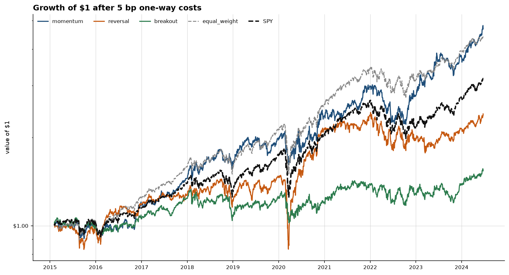
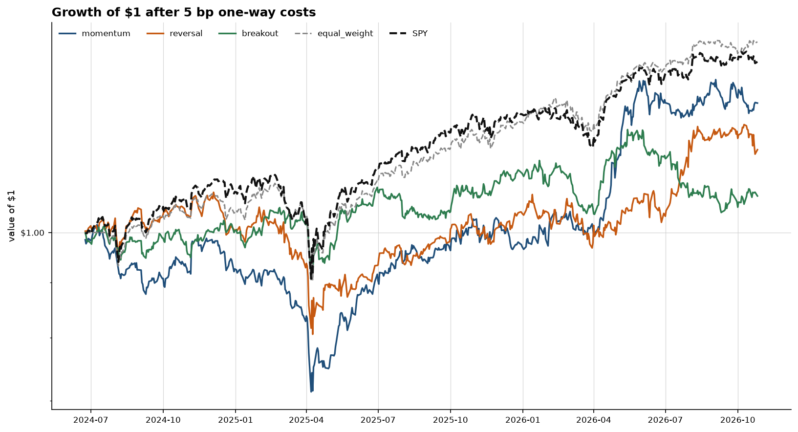
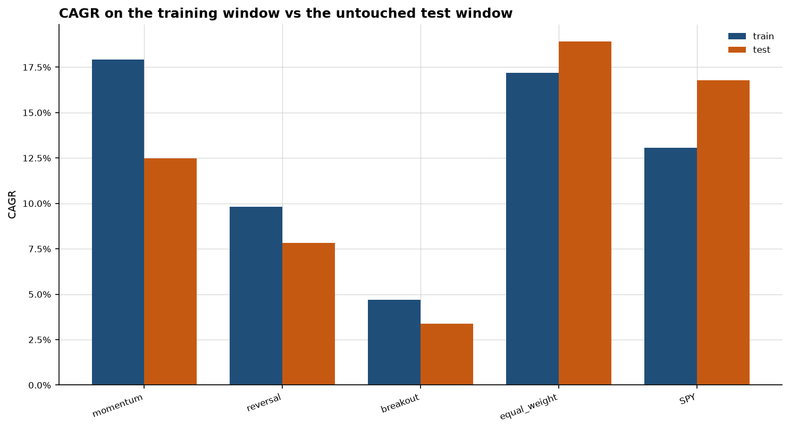
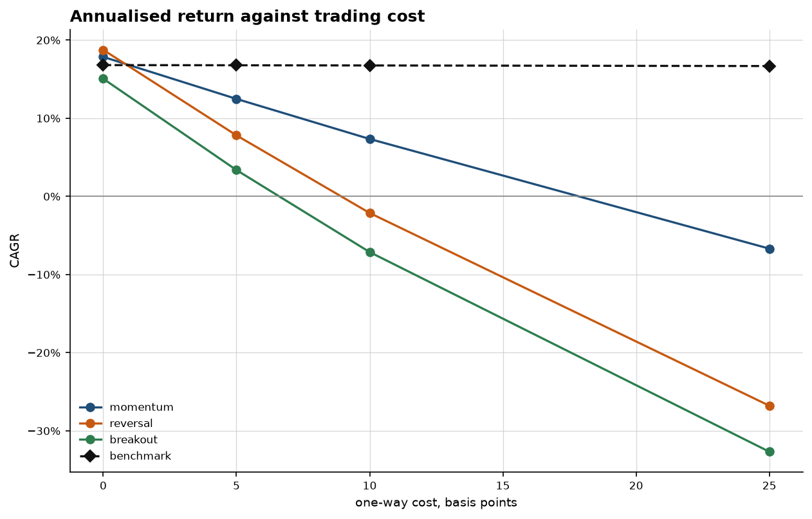

# Validation — validation

On the untouched test window, none of the three strategies beat equal-weight buy-and-hold of the same 62 names (18.9% CAGR). That is the result. Chronological split at **2024-06-20** (80% train / 20% test) after warmup from 2015-02-03. Benchmark SPY. Parameters were not retuned on the test window. No strategy tripped the configured Sharpe-drop overfit flag.

## 1. Method

- **Universe.** 62 tradable names + SPY. Listed in `config/validation.yml`. Still a list of names that exist today — survivorship is not cured by listing more of them.
- **Strategies.** The Milestone 2 rules, unchanged: 20-day momentum (skip 1), 5-day vol-scaled reversal, 20-day breakout. Top 10, long only.
- **Costs.** 5 bp one-way = 1 commission + 4 slippage. Sweep at [0.0, 5.0, 10.0, 25.0] bp.
- **Portfolio caps.** max_weight=15%; max_participation=2% of 20-day median dollar volume at an assumed book of $1,000,000. Clipped mass stays cash.
- **Fill.** Signal at t's close → raw open of t+1. P&L on the adjusted open. No intraday stop.
- **Split.** Chronological 80% / 20% on decision dates after warmup. Boundary **2024-06-20**. Train 2015-02-03 → 2024-06-18 (2360 decisions). Test 2024-06-20 → 2026-10-26 (590 decisions). No shuffle.
- **Config hash.** `7c2a3479545401637ca2e40770d5915326dcb508e607a43f88a5ad06968eb9e8` — the exact bytes of `config/validation.yml`.
- **Parameters.** Not searched against the test window. Fixed in Milestone 2 / this config before the test metrics were computed.

## 2. Train vs test

| book         | train CAGR   | test CAGR   | CAGR gap   | train Sharpe   | test Sharpe   | Sharpe gap   | test max DD   | test VaR 95%   | test turnover   |
|:-------------|:-------------|:------------|:-----------|:---------------|:--------------|:-------------|:--------------|:---------------|:----------------|
| momentum     | 17.9%        | 12.5%       | -5.4 pp    | 0.80           | 0.60          | -0.20        | -29.8%        | -1.8%          | 46.67x          |
| reversal     | 9.8%         | 7.8%        | -2.0 pp    | 0.45           | 0.38          | -0.07        | -26.0%        | -1.8%          | 96.64x          |
| breakout     | 4.7%         | 3.4%        | -1.3 pp    | 0.24           | 0.16          | -0.08        | -16.1%        | -1.6%          | 107.06x         |
| equal_weight | 17.2%        | 18.9%       | +1.7 pp    | 0.89           | 1.10          | 0.22         | -18.5%        | -1.1%          | 0.21x           |
| SPY          | 13.1%        | 16.8%       | +3.7 pp    | 0.69           | 0.90          | 0.21         | -19.8%        | -1.4%          | 0.21x           |

CAGR, vol, Sharpe, Sortino, max drawdown, empirical 95% VaR, hit rate, holding period, turnover, and CAPM alpha — train and test. The gap columns are the headline. VaR is the empirical 5th percentile of daily returns, not a Gaussian approximation.

**momentum.** Train CAGR 17.9% (Sharpe 0.80), test CAGR 12.5% (Sharpe 0.60). Gaps: CAGR -5.4 pp, Sharpe -0.20. Test max drawdown -29.8%, empirical 95% VaR -1.8% per day, turnover 46.67x, mean gross exposure 100.0%. Vs SPY test alpha 0.1%/yr.

**reversal.** Train CAGR 9.8% (Sharpe 0.45), test CAGR 7.8% (Sharpe 0.38). Gaps: CAGR -2.0 pp, Sharpe -0.07. Test max drawdown -26.0%, empirical 95% VaR -1.8% per day, turnover 96.64x, mean gross exposure 100.0%. Vs SPY test alpha -5.3%/yr.

**breakout.** Train CAGR 4.7% (Sharpe 0.24), test CAGR 3.4% (Sharpe 0.16). Gaps: CAGR -1.3 pp, Sharpe -0.08. Test max drawdown -16.1%, empirical 95% VaR -1.6% per day, turnover 107.06x, mean gross exposure 100.0%. Vs SPY test alpha -5.8%/yr.

**Equal-weight buy-and-hold** of the same universe: train CAGR 17.2%, test CAGR 18.9%. **SPY** train 13.1%, test 16.8%. On the test window the universe itself beat SPY, so clearing the index is not enough — clearing equal-weight is the harder null.

## 3. Overfitting check

A strategy is flagged when its test Sharpe is more than 40% below its train Sharpe (test < train × 0.60), or when train Sharpe is already non-positive and test is worse. This is reported in the output, not omitted.

| strategy   | train Sharpe   | test Sharpe   | flag   | note   |
|:-----------|:---------------|:--------------|:-------|:-------|
| momentum   | 0.80           | 0.60          | no     | —      |
| reversal   | 0.45           | 0.38          | no     | —      |
| breakout   | 0.24           | 0.16          | no     | —      |

**No strategy tripped the configured flag.** That is not a certificate of robustness — the test window is one path, the universe is survivors, and a quiet flag can still be a lucky draw.

## 4. Costs on each window

Same weights, resimulated at each cost. Breakeven is versus SPY on that window.

**Train**

| book     | 0 bp   | 5 bp   | 10 bp   | 25 bp   |
|:---------|:-------|:-------|:--------|:--------|
| momentum | 23.5%  | 17.9%  | 12.6%   | -2.1%   |
| reversal | 20.9%  | 9.8%   | -0.2%   | -25.2%  |
| breakout | 16.5%  | 4.7%   | -5.9%   | -31.7%  |
| SPY      | 13.1%  | 13.1%  | 13.0%   | 13.0%   |

- momentum: breakeven vs SPY near 9.6 bp one-way
- reversal: breakeven vs SPY near 3.5 bp one-way
- breakout: breakeven vs SPY near 1.5 bp one-way

**Test**

| book     | 0 bp   | 5 bp   | 10 bp   | 25 bp   |
|:---------|:-------|:-------|:--------|:--------|
| momentum | 17.9%  | 12.5%  | 7.3%    | -6.7%   |
| reversal | 18.8%  | 7.8%   | -2.1%   | -26.8%  |
| breakout | 15.1%  | 3.4%   | -7.1%   | -32.7%  |
| SPY      | 16.8%  | 16.8%  | 16.8%   | 16.7%   |

- momentum: breakeven vs SPY near 1.0 bp one-way
- reversal: breakeven vs SPY near 0.9 bp one-way
- breakout: behind SPY even at the cheapest cost on the grid

## 5. Bias and limitation analysis

These are the risks that are still live after this milestone. Naming them is the deliverable; curing them is later work.

1. **Look-ahead / leakage.** Features and scores at date t use only rows with date ≤ t (truncation tests in `tests/test_backtest.py`). Fills are the next open, never the signal close (`test_the_fill_is_the_next_open_and_not_the_signal_close`). A provisional last bar from an unclosed session is still not refused (ROADMAP phase 4) — if this report was built mid-session, the newest score will move by the close.
2. **Overfitting.** Parameters were not grid-searched on this sample. The train/test Sharpe gap is still the honest check: section 3 flags a drop above the configured threshold. Running the test window more than once while tuning would invalidate that check; this config's SHA-256 is recorded so a later retune is visible.
3. **Data leakage through the universe.** Membership is today's list. Names that delisted, went bankrupt, or never made it into this YAML are absent. Every CAGR here is conditional on survival. A point-in-time constituent list is ROADMAP phase 3.
4. **Unstable / regime-dependent parameters.** A 20-day momentum window that worked in a long equity bull tape can fail when cross-sectional dispersion collapses. The test window is one regime draw; it is not a stress library.
5. **Cost model risk.** Commission and slippage are flat bp, identical across names. TLT and a single stock do not cost the same. The sweep shows sensitivity to the level, not a market-impact model. Participation is capped against trailing ADV at an assumed NAV; that cap is still an assumption about the book size.
6. **Price-basis risk.** Breakout still scores `adj_close` (total return). A dividend looks like a downside break. The split-adjusted, not-dividend-adjusted series is ROADMAP phase 2.
7. **Survivorship and selection.** Expanding from 10 names to 62 diversifies idiosyncratic bets; it does not remove the bias that every name printed a quote through the end of the sample.
8. **Multiple testing.** Three strategies, two benchmarks, a cost grid, and a train/test cut produce many numbers. The report leads with the equal-weight null and the overfit flag so a single lucky Sharpe is not the takeaway.

## 6. Figures

**Train window — growth of $1**



**Test window — growth of $1 (untouched)**



**Train vs test CAGR at the stated cost**



**Test-window cost sweep**



## 7. Reproducibility

```bash
python -m marketengine --config config/validation.yml run
python -m marketengine --config config/validation.yml validate
python submission/milestone3/capture.py
```

Config path: `config/validation.yml`. SHA-256: `7c2a3479545401637ca2e40770d5915326dcb508e607a43f88a5ad06968eb9e8`. Split boundary: **2024-06-20**. Train fraction: 80%. Stated cost: 5 bp one-way.

